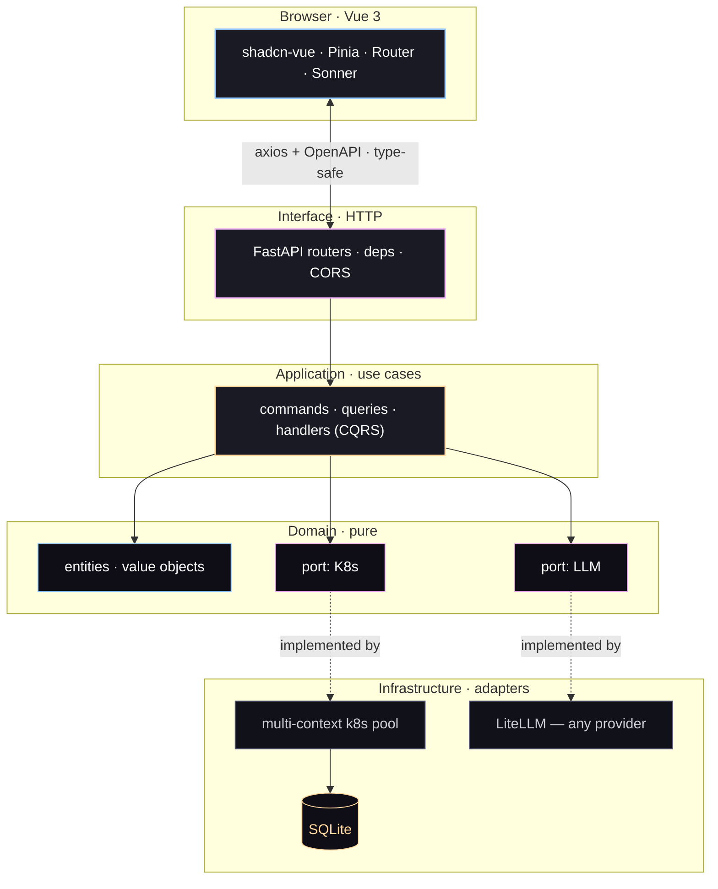

<!--
  Spotlight README — designed for GitHub rendering at 980px.
  Structure: hero → nav → ToC → pitch → origin → tour → features → comparison →
  AI demo → architecture → quickstart → stack → providers → roadmap → contributing →
  layout → FAQ → development → community → sponsor → star history → footer
-->

<div align="center">


<br/>

<table align="center" cellpadding="0" cellspacing="0" style="margin: 8px auto 12px; border-collapse:collapse;">
  <tr>
    <td align="center" style="padding:8px 18px;background:#0B0B12;color:#FAFAFA;border:1px solid #26253A;border-radius:999px;font-family:ui-sans-serif,system-ui,sans-serif;font-size:14px;font-weight:600;">🌐 multi-cluster</td>
    <td align="center" width="8"></td>
    <td align="center" style="padding:8px 18px;background:#EFADF7;color:#18181B;border:1px solid #EFADF7;border-radius:999px;font-family:ui-sans-serif,system-ui,sans-serif;font-size:14px;font-weight:600;">🤖 AI logs</td>
    <td align="center" width="8"></td>
    <td align="center" style="padding:8px 18px;background:#8EC5FF;color:#18181B;border:1px solid #8EC5FF;border-radius:999px;font-family:ui-sans-serif,system-ui,sans-serif;font-size:14px;font-weight:600;">🧠 bring your LLM</td>
    <td align="center" width="8"></td>
    <td align="center" style="padding:8px 18px;background:#FFD69B;color:#18181B;border:1px solid #FFD69B;border-radius:999px;font-family:ui-sans-serif,system-ui,sans-serif;font-size:14px;font-weight:600;">🔓 self-host</td>
  </tr>
</table>

<p align="center" style="font-size:20px;color:#1A1A24;">
  <strong>A Kubernetes dashboard that thinks with you.</strong>
</p>

<br/>

<a href="#-quick-start"></a>&nbsp;
<a href="#-star-history"></a>&nbsp;
<a href="https://github.com/mcgrapeng/Spotlight/discussions"></a>&nbsp;
<a href="#-sponsor--funding"></a>

<br/>


<br/>

<a href="./README.md"><b>English</b></a> &nbsp;·&nbsp;
<a href="./README.zh-CN.md">简体中文</a>

<br/>

**Quick links:**
<a href="#-the-pitch">Pitch</a> ·
<a href="#-why-we-built-this">Why</a> ·
<a href="#-60-second-tour">Tour</a> ·
<a href="#-what-you-get">Features</a> ·
<a href="#-vs-the-field">Compare</a> ·
<a href="#-ai-in-action">AI Demo</a> ·
<a href="#-quick-start">Quickstart</a> ·
<a href="#-faq">FAQ</a> ·
<a href="#-community">Community</a>

</div>

<br/>

<p align="center">
  
</p>

<br/>

##  &nbsp; At a glance

Spotlight is the **Kubernetes dashboard for the dev who already knows `kubectl`** — it pulls every cluster in your kubeconfig into one view, streams Pod logs in real time, and hands the messy ones to an LLM **you pick** for an instant, contextual explanation.

- 🧭 **Multi-cluster kubeconfig, one UI** — switch contexts live, no restart
- 📜 **Real-time log streaming (SSE)** — multi-pod select, ANSI preserved, dedup, download
- 🤖 **AI log explainer, any model** — OpenAI · Anthropic · Bedrock · Gemini · Ollama · 100+ via LiteLLM
- ⌨️ **Keyboard-first** — `⌘K` palette, `g d / p / n / e / f / a` page jumps
- 🧱 **Pluggable auth** — bearer · session · Teleport tsh · your own plugin (one file)
- 🔍 **Type-safe end-to-end** — Pydantic v2 → OpenAPI → `openapi-typescript`

<br/>

<p align="center">
  
</p>

<br/>

##  &nbsp; Table of contents

| Section | What you'll find |
|---|---|
| [The pitch](#-the-pitch) | The one-liner that explains everything |
| [Why we built this](#-why-we-built-this) | The origin story |
| [60-second tour](#-60-second-tour) | Screenshots of every key screen |
| [What you get](#-what-you-get) | Feature grid — 8 capabilities |
| [vs. the field](#-vs-the-field) | Spotlight vs kubectl / Dashboard / Lens |
| [AI in action](#-ai-in-action) | Real output shape from the AI analyzer |
| [How it's built](#-how-it-s-built) | Hexagonal architecture diagram |
| [Quick start](#-quick-start) | 3 commands to run |
| [Stack](#-stack) | Tech stack badges |
| [AI providers](#-ai-providers) | LiteLLM provider table |
| [Coming next](#-coming-next) | Roadmap |
| [Contributing](#-contributing) | How to help |
| [Project layout](#-project-layout) | Repo structure |
| [FAQ](#-faq) | Frequently asked questions |
| [Development](#-development) | Local dev setup |
| [Community](#-community) | Discussions, issues, chat |
| [Sponsor / funding](#-sponsor--funding) | Support the project |
| [Star history](#-star-history) | Growth chart |
| [Licence · Acknowledgements](#-licence--acknowledgements) | MIT + credits |

<br/>

<p align="center">
  
</p>

<br/>

##  &nbsp; The pitch

<table align="center" cellpadding="0" cellspacing="0" style="margin: 0 auto; border-collapse: collapse; max-width: 720px;">
<tr>
<td style="padding: 28px 36px; background: linear-gradient(180deg, #FAFAFA 0%, #F5F5F8 100%); border-left: 4px solid #EFADF7; border-radius: 8px;">
  <p style="margin: 0; font-family: ui-sans-serif, system-ui, -apple-system, 'Inter', sans-serif; font-size: 19px; line-height: 1.65; color: #0B0B12;">
    <code style="background: rgba(0,0,0,.06); padding: 2px 7px; border-radius: 4px; color: #0B0B12; font-weight: 700;">kubectl</code>
    tells you <strong>what</strong> is happening.<br/>
    <code style="background: rgba(0,0,0,.06); padding: 2px 7px; border-radius: 4px; color: #0B0B12; font-weight: 700;">Kubernetes&nbsp;Dashboard</code>
    tells you <strong>where</strong> it is.<br/>
    <code style="background: rgba(0,0,0,.06); padding: 2px 7px; border-radius: 4px; color: #18181B; font-weight: 700;">Spotlight</code>
    tells you <strong style="background: linear-gradient(90deg, #8EC5FF, #EFADF7, #FFD69B); -webkit-background-clip: text; background-clip: text; color: transparent;"><em>why</em></strong>.
  </p>
</td>
</tr>
</table>

<br/>

<p align="center">
  
</p>

<br/>

##  &nbsp; Why we built this

> *We were debugging a production incident at 2 a.m. The pod was crash-looping. `kubectl logs` showed 21,320 restarts. The Dashboard showed the pod was "Running". Neither told us **why**. We spent 40 minutes grepping through logs before finding an OOMKilled line buried at position 88. That was the moment we decided: the tool that shows you the dashboard should also show you the diagnosis.*

Every AI team eventually hits the same wall: **kubectl gives you the what, the Dashboard gives you the where, but nobody gives you the why.** Logs are scattered across pods, restarts, and events. The answer is always there — buried in a 200-line log dump that no human wants to read at 2 a.m.

Spotlight is the layer on top that connects the dots. It pulls every cluster into one view, streams logs in real time, and hands the messy ones to an LLM **you pick** for a contextual explanation. No SaaS, no vendor lock, your cluster, your data, your model.

<br/>

<p align="center">
  
</p>

<br/>

##  &nbsp; 60-second tour

<table align="center">
<tr>
<td width="50%" valign="top" align="center" style="padding: 8px;">

**01 · Log in**


<sub>Bearer, Teleport tsh, or session — 30 seconds, no signup.</sub>

</td>
<td width="50%" valign="top" align="center" style="padding: 8px;">

**02 · Watch the cluster**


<sub>Health, pressure, signals on one screen.</sub>

</td>
</tr>
<tr>
<td width="50%" valign="top" align="center" style="padding: 8px;">

**03 · Pick the noisy Pod**


<sub>Live status, restart counts, namespace filter.</sub>

</td>
<td width="50%" valign="top" align="center" style="padding: 8px;">

**04 · Let the LLM explain**


<sub>Pull the last 200 lines, click <em>Analyze</em>.</sub>

</td>
</tr>
</table>

<br/>

<p align="center">
  
</p>

<br/>

##  &nbsp; What you get

<table>
<tr>
<td width="50%" valign="top">

### 🧭 Multi-cluster, one UI
Switch contexts live — the exact `KUBECONFIG` your shell already respects. No restart.

</td>
<td width="50%" valign="top">

### 📜 Real-time log streaming (SSE)
Multi-pod select, ANSI color preserved, deduplicated, download.

</td>
</tr>
<tr>
<td width="50%" valign="top">

### 🤖 AI log explainer, any model
Bring your own key — OpenAI · Anthropic · Bedrock · Gemini · Ollama · 100+ via LiteLLM.

</td>
<td width="50%" valign="top">

### ⌨️ Keyboard-first
`⌘K` palette · `g d / p / n / e / f / a` to leap between pages · no mouse needed.

</td>
</tr>
<tr>
<td width="50%" valign="top">

### 🧱 Pluggable auth
Bearer · session · Teleport tsh · your own plugin (one file).

</td>
<td width="50%" valign="top">

### 🔍 Type-safe, end-to-end
Pydantic v2 → OpenAPI → `openapi-typescript`. Frontend can't drift from backend.

</td>
</tr>
<tr>
<td width="50%" valign="top">

### 🌑 Appica design language
Pure black `#18181B` on pure white `#FAFAFA` · 1 px borders · one accent gradient.

</td>
<td width="50%" valign="top">

### 🧪 100 % testable
Hexagonal architecture · every port mocked · every adapter tested · e2e covers the critical paths.

</td>
</tr>
</table>

<br/>

<p align="center">
  
</p>

<br/>

##  &nbsp; vs. the field

| &nbsp; | `kubectl` | Dashboard | Lens | **Spotlight** |
|---|---|---|---|---|
| Multi-cluster switch | `kubectx` | manual | ✔ | **✔ live** |
| Real-time log stream | `kubectl logs -f` | ✔ | ✔ | **✔ multi-pod + dedup** |
| AI log explainer | ✗ | ✗ | ✗ | **✔ any LLM** |
| Pluggable auth | ✗ | ✗ | partial | **✔ one file** |
| Type-safe API → UI | ✗ | ✗ | ✗ | **✔ Pydantic → TS** |
| Self-host, no signup | ✔ | ✔ | partial | **✔** |

> Spotlight does not replace `kubectl`. It sits *on top* — gives you the dashboard, the trail, and the diagnosis, fast.

<br/>

<p align="center">
  
</p>

<br/>

##  &nbsp; AI in action

> Pull up to 200 lines from any pod, click *Analyze*, pick a model — real output shape:

```text
▸ AI · claude-3-5-sonnet · 1.42s · tokens 412 in / 286 out

  Root cause
    The pod is being OOMKilled. Container RSS hit the 512 MiB limit at
    17:42:08; the kernel sent SIGKILL (exit 137); Kubernetes restarted
    the container 21,320 times in the last 5 minutes.

  Evidence
    L17  "oom score adj = 950"
    L23  "memory.peak = 512MiB / limit 512MiB"
    L88  "loki-write: signal SIGKILL, exit code 137"

  Suggested fix
    • Raise memory.limit to 768 MiB in the Helm values, or
    • Drop WAL retention from 24h → 6h in the ingester config, or
    • Shard the tenant — split by labels across 3 replicas.
```

> [!TIP]
> **Swap models without restart.** Change `AI_PROVIDER` in `.env`, save, pick a different model in the UI. The same call routes to OpenAI, Anthropic, Bedrock, Gemini, Ollama, or **any OpenAI-compatible endpoint**.

<br/>

<p align="center">
  
</p>

<br/>

##  &nbsp; How it's built

Hexagonal / Clean Architecture — the **domain knows nothing about Kubernetes, AI, or HTTP**; adapters do.



> **Want to add an auth provider, log source, or LLM?** Add an `infrastructure/<thing>/` adapter that implements the matching port, register it. Nothing else moves.

<br/>

<p align="center">
  
</p>

<br/>

##  &nbsp; Quick start

**Spotlight is two processes. Run them, point them at your kubeconfig, open `http://localhost:5173`.**

```bash
# 1. Backend — FastAPI on :8002
cd backend
python -m venv .venv && source .venv/bin/activate
pip install -r requirements.txt
cp .env.example .env
uvicorn app.main:app --reload --port 8002

# 2. Frontend — Vue 3 on :5173, in a second terminal
cd frontend
pnpm install
pnpm dev
```

Open <http://localhost:5173>. Log in with any `Authorization: Bearer <token>` — set `API_TOKEN=<your-token>` in `backend/.env`, **or leave it empty** for local open mode (the app logs a startup warning either way).

> **Have Teleport?** Set `TELEPORT_PROXY` / `TELEPORT_AUTH` / `TELEPORT_CLUSTER` in `.env`. Spotlight issues per-session `tsh login` credentials — no kubeconfig needed.

<br/>

<p align="center">
  
</p>

<br/>

##  &nbsp; Stack

**Backend**
<a href="#"></a>
<a href="#"></a>
<a href="#"></a>
<a href="#"></a>
<a href="#"></a>

**Frontend**
<a href="#"></a>
<a href="#"></a>
<a href="#"></a>
<a href="#"></a>
<a href="#"></a>

**Tests**
<a href="#"></a>
<a href="#"></a>
<a href="#"></a>
<a href="#"></a>

<br/>

<p align="center">
  
</p>

<br/>

##  &nbsp; AI providers

Powered by **LiteLLM**. One env-var to swap, model picked from the UI.

| Provider | `AI_PROVIDER=` | Set in env |
|---|---|---|
| **OpenAI** | `openai` | `OPENAI_API_KEY` |
| **Anthropic** | `anthropic` | `ANTHROPIC_API_KEY` |
| **Azure OpenAI** | `azure` | `AZURE_API_KEY` · `AZURE_API_BASE` · `AZURE_API_VERSION` |
| **AWS Bedrock** | `bedrock` | `AWS_ACCESS_KEY_ID` · `AWS_REGION` |
| **Google Gemini / Vertex** | `gemini` / `vertex` | `GEMINI_API_KEY` / `VERTEX_PROJECT` |
| **Ollama (local)** | `ollama` | `OLLAMA_API_BASE=http://host:11434` |
| **OpenRouter** | `openrouter` | `OPENROUTER_API_KEY` |
| **Any OpenAI-compatible API** | `custom` | `AI_API_BASE` · `AI_API_KEY` |

<br/>

<p align="center">
  
</p>

<br/>

##  &nbsp; Coming next

- [x] <sub>`v2.0`</sub> &nbsp; **Now** — multi-cluster kubeconfig, SSE log streaming, LiteLLM, Appica UI v6, hexagonal backend.
- [ ] <sub>`v2.1`</sub> &nbsp; Helm chart deploy · single-binary mode · SQLite → Postgres migration.
- [ ] <sub>`v2.2`</sub> &nbsp; RBAC-aware views · multi-user session isolation · audit log UI.
- [ ] <sub>`v3.0`</sub> &nbsp; Plugin SDK (third-party LLM analyzers, custom log parsers) · authenticated **public read-only share** links.

> Open a Discussion thread if a feature matters to you — the roadmap is shaped by what people actually use.

<br/>

<p align="center">
  
</p>

<br/>

##  &nbsp; Contributing

Any-size contribution is welcome — bug reports, docs, code, AI provider adapters.

```bash
git clone https://github.com/mcgrapeng/Spotlight.git && cd Spotlight

cd backend && source .venv/bin/activate
pip install -r requirements.txt
pytest -q

cd ../frontend && pnpm install
pnpm test           # Vitest — unit
pnpm test:e2e       # Playwright — browser
```

> Per-package dev guide: [`backend/README.md`](./backend/README.md) · [`frontend/README.md`](./frontend/README.md)
> Architecture rule: **ports and adapters only** — `app/` never imports `kubernetes` or `litellm` directly.

<br/>

<p align="center">
  
</p>

<br/>

##  &nbsp; Project layout

```
Spotlight/
├── backend/                   FastAPI · hexagonal / clean architecture
│   ├── app/
│   │   ├── application/       commands · queries · handlers (use cases)
│   │   ├── domain/            entities · value objects · ports
│   │   ├── infrastructure/    adapters: k8s, db, logging, LLM, auth
│   │   ├── interface/api/     FastAPI routers / DTOs
│   │   └── main.py
│   ├── tests/                 pytest — unit + integration
│   └── requirements.txt
├── frontend/                  Vue 3 + Vite + Tailwind + shadcn-vue
│   ├── src/
│   │   ├── components/        ui/, layout/, common/, pod/, dashboard/, log/, ai/
│   │   ├── views/             8 pages (Login, Dashboard, Pods, PodDetail, Nodes, …)
│   │   ├── stores/            Pinia
│   │   ├── api/               axios + openapi-typescript generated
│   │   └── styles/            design tokens
│   └── package.json
├── assets/                    brand banner / mark / divider / README screenshots
├── LICENSE                    MIT
├── README.md  ·  README.zh-CN.md
└── …                          config + tooling
```

<br/>

<p align="center">
  
</p>

<br/>

##  &nbsp; FAQ

<details>
<summary><b>Is Spotlight production-ready?</b></summary>

Yes. v2.0 ships with hexagonal architecture, typed API contracts, SSE log streaming, and a test suite that covers every port. The AI analyzer is the only feature that depends on an external LLM — everything else runs entirely offline.

</details>

<details>
<summary><b>How does Spotlight compare to Lens or k9s?</b></summary>

Lens is a full IDE for Kubernetes — great for exploring resources, but it doesn't do AI log analysis. k9s is a terminal UI — fast and minimal, but no web dashboard. Spotlight sits between them: a web dashboard with AI-powered log diagnosis. See the [comparison table](#-vs-the-field) above.

</details>

<details>
<summary><b>Can I use my own LLM endpoint?</b></summary>

Yes. Set `AI_PROVIDER=custom` and `AI_API_BASE` to any OpenAI-compatible endpoint (Ollama, vLLM, LM Studio, etc.). The model is picked from the UI — no restart needed.

</details>

<details>
<summary><b>Does Spotlight store my cluster credentials?</b></summary>

No. Spotlight reads your `KUBECONFIG` at runtime and never persists cluster credentials. The `API_TOKEN` for login is stored in `backend/.env` (gitignored). Teleport sessions are per-session and expire.

</details>

<details>
<summary><b>How do I add a new auth provider?</b></summary>

Implement the `AuthPlugin` interface in `backend/app/infrastructure/auth/plugins/`, register it in the plugin registry, and set `AUTH_PROVIDER=<your-plugin-id>` in `.env`. The login form auto-adapts to the plugin's `form_fields()`.

</details>

<details>
<summary><b>Is there a Docker image?</b></summary>

Not yet — v2.1 roadmap includes a Helm chart and single-binary mode. For now, run the two processes directly (see [Quick start](#-quick-start)).

</details>

<br/>

<p align="center">
  
</p>

<br/>

##  &nbsp; Development

### Prerequisites

- Python 3.11+ · Node.js 20+ · pnpm
- A `kubeconfig` with at least one context (any cluster, including `minikube` / `kind`)

### Local dev

```bash
# Backend (port 8002, hot-reload)
cd backend && source .venv/bin/activate
uvicorn app.main:app --reload --port 8002

# Frontend (port 5173, hot-reload)
cd frontend && pnpm dev
```

### Tests

```bash
# Backend — unit + integration
cd backend && pytest -q

# Frontend — unit (Vitest)
cd frontend && pnpm test

# Frontend — E2E (Playwright, headless Chromium)
cd frontend && pnpm test:e2e
```

### Type checking

```bash
cd frontend && pnpm types:check   # OpenAPI → TS contract check
```

> **Architecture rule:** `app/` never imports `kubernetes` or `litellm` directly. Everything crosses a port defined in `domain/`. To add a new auth provider, LLM, or log source — implement the matching adapter and register it.

<br/>

<p align="center">
  
</p>

<br/>

##  &nbsp; Community

- 💬 **[Discussions](https://github.com/mcgrapeng/Spotlight/discussions)** — ask questions, share use cases, propose features
- 🐛 **[Issues](https://github.com/mcgrapeng/Spotlight/issues)** — bug reports and feature requests
- 📖 **[Contributing guide](#-contributing)** — how to get started
- 📦 **[Releases](https://github.com/mcgrapeng/Spotlight/releases)** — changelog and version history

<br/>

<p align="center">
  
</p>

<br/>

##  &nbsp; Sponsor / funding

<table align="center" cellpadding="0" cellspacing="0" style="margin: 0 auto; border-collapse: collapse; max-width: 640px;">
<tr>
<td style="padding: 22px 28px; background: linear-gradient(135deg, #FFF7E6 0%, #FFE6F6 100%); border: 1px solid #FFD69B; border-radius: 12px; text-align: left;">
  <div style="font-family: ui-sans-serif, system-ui, sans-serif; font-size: 18px; font-weight: 700; color: #18181B; margin-bottom: 8px;">
    ❤ &nbsp;Built nights &amp; weekends.
  </div>
  <div style="font-family: ui-sans-serif, system-ui, sans-serif; font-size: 14px; color: #1A1A24; line-height: 1.6;">
    Spotlight is MIT-licensed, free for everyone. If it saved your team at 2 a.m.,
    a sponsorship keeps the build moving.
  </div>
  <div style="margin-top: 12px;">
    <a href="https://github.com/sponsors/mcgrapeng" style="display:inline-block; padding: 8px 16px; background:#18181B; color:#FFD69B; border-radius:6px; font-weight:600; text-decoration:none; font-size: 14px;">❤ &nbsp;Sponsor on GitHub</a>
  </div>
</td>
</tr>
</table>

<br/>

<p align="center">
  
</p>

<br/>

##  &nbsp; ⭐ Star history

<a href="https://star-history.com/#mcgrapeng/Spotlight&Date">
  <picture>
    <source media="(prefers-color-scheme: dark)" srcset="https://api.star-history.com/svg?repos=mcgrapeng/Spotlight&type=Date&theme=dark" />
    <source media="(prefers-color-scheme: light)" srcset="https://api.star-history.com/svg?repos=mcgrapeng/Spotlight&type=Date" />
    
  </picture>
</a>

<br/>

<p align="center">
  
</p>

<br/>

##  &nbsp; Licence · Acknowledgements

[MIT](./LICENSE) — do anything, just keep the copyright.

Spotlight rides on **FastAPI**, **Pydantic**, **SQLAlchemy**, **LiteLLM**, **kubernetes-python**, **Vue 3**, **Vite**, **Tailwind CSS**, **shadcn-vue**, **Radix Vue**, **Pinia**, **Lucide**, **Axios**, **Playwright**, **Vitest**, **pytest**, **structlog**.

<br/>

<div align="center" style="padding: 40px 0 16px;">


<br/><br/>

<sub>Spotlight · built for the dev who already knows <code>kubectl</code>.</sub>

<br/><br/>

<table align="center" cellpadding="0" cellspacing="0" style="border-collapse: collapse; margin: 0 auto;">
<tr>
<td align="center" style="padding: 4px 14px;"><a href="./README.md"><b>📖 Docs</b></a></td>
<td align="center" style="padding: 4px 14px; color:#D1D9E0;">·</td>
<td align="center" style="padding: 4px 14px;"><a href="https://github.com/mcgrapeng/Spotlight/issues"><b>🐛 Issues</b></a></td>
<td align="center" style="padding: 4px 14px; color:#D1D9E0;">·</td>
<td align="center" style="padding: 4px 14px;"><a href="https://github.com/mcgrapeng/Spotlight/discussions"><b>💬 Discussions</b></a></td>
<td align="center" style="padding: 4px 14px; color:#D1D9E0;">·</td>
<td align="center" style="padding: 4px 14px;"><a href="https://github.com/mcgrapeng/Spotlight/releases"><b>📦 Releases</b></a></td>
<td align="center" style="padding: 4px 14px; color:#D1D9E0;">·</td>
<td align="center" style="padding: 4px 14px;"><a href="https://github.com/sponsors/mcgrapeng"><b>❤ Sponsor</b></a></td>
</tr>
</table>

</div>
