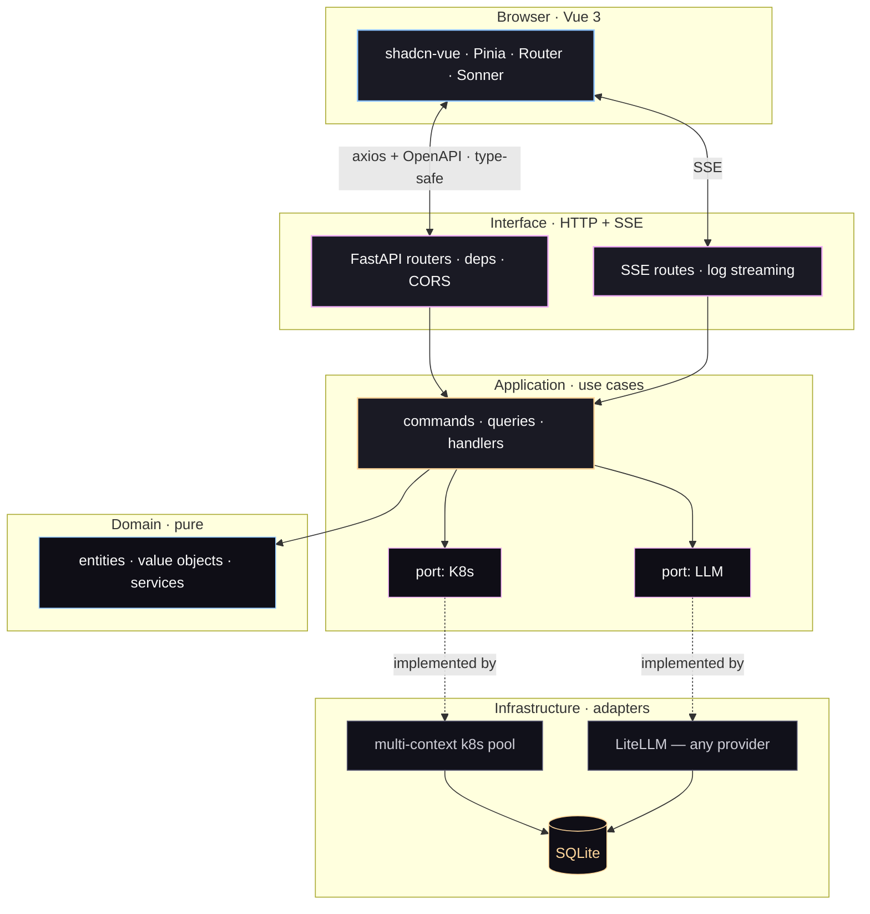

<div align="center">


<br/>

**A Kubernetes dashboard that thinks with you.**

<br/>

<a href="#-quick-start"></a>&nbsp;
<a href="https://github.com/mcgrapeng/Spotlight/discussions"></a>&nbsp;
<a href="https://github.com/sponsors/mcgrapeng"></a>

<br/>

<a href="./README.md"><b>English</b></a> &nbsp;·&nbsp; <a href="./README.zh-CN.md">简体中文</a>

<br/>


</div>

## 📸 Screenshot


<sub>Every context in your kubeconfig on one screen: health, pressure, and the restart counts that explain your 3 a.m.</sub>

## 🎯 Why

`kubectl` tells you **what** is happening.
Kubernetes Dashboard tells you **where** it is.
**Spotlight** tells you ***why***.

> We were debugging a production incident at 2 a.m. The pod was crash-looping. `kubectl logs` showed 21,320 restarts. The Dashboard cheerfully reported the pod as "Running". Neither told us why — the `OOMKilled` line was buried at position 88 of a 200-line dump. That gap, *dashboard without diagnosis*, is what Spotlight closes.

No SaaS, no vendor lock. Your cluster, your data, your model.

## ✨ Features

- **Multi-cluster, one UI** — every context in your kubeconfig, switchable live. No restart.
- **Real-time log stream** — SSE, multi-pod select, ANSI color preserved, deduplicated, downloadable.
- **AI explainer, any model** — OpenAI · Anthropic · Bedrock · Gemini · Ollama · 100+ via LiteLLM.
- **Keyboard-first** — `⌘K` palette, `g d/p/n/e/f/a` page jumps. Mouse optional.
- **Pluggable auth** — bearer · session · Teleport `tsh` · your own plugin, one file.
- **Type-safe end to end** — Pydantic v2 → OpenAPI → `openapi-typescript`. The UI cannot drift from the API.

## 🚀 Quick start

Two processes: the FastAPI backend and the Vue dev server. Ports are never hardcoded — pick what is free on your machine and tell each side about it.

```bash
# 1 · backend — pick any free port
cd backend
python -m venv .venv && source .venv/bin/activate
pip install -r requirements.txt
cp .env.example .env
uvicorn app.main:app --reload --port 8002
```

```bash
# 2 · frontend — in a second terminal
cd frontend
pnpm install
pnpm dev
```

**Tell the frontend where the backend is.** It proxies `/api` to `VITE_API_PROXY`, which defaults to
`http://127.0.0.1:8000` — so if you started uvicorn on `8002` (or any other port), set it before
running `pnpm dev`, or the frontend will silently proxy to a dead port:

```bash
# frontend/.env
VITE_API_PROXY=http://127.0.0.1:8002
```

**Frontend port:** leave `VITE_PORT` unset and Vite picks a free one, walking up if the default is
busy. It prints the URL it actually bound — open that, don't assume a fixed port.

<details>
<summary>Auth, Teleport, and locking the API down</summary>

For local development leave `API_TOKEN` and `TELEPORT_*` unset — the API starts open and logs a startup warning. To require a token, set `API_TOKEN=<your-token>` in `backend/.env` and log in with any `Authorization: Bearer <token>`.

**Using Teleport?** Set `TELEPORT_PROXY`, `TELEPORT_AUTH` and `TELEPORT_CLUSTER` in `.env`. Spotlight issues per-session `tsh login` credentials and needs no kubeconfig at all.

**Writing your own auth plugin?** Implement `AuthPlugin` in `backend/app/infrastructure/auth/plugins/`, register it in that package's `REGISTRY`, and set `AUTH_PROVIDER=<your-plugin-id>`. The login form adapts itself to the plugin's `form_fields()`.

</details>

## ⚖️ Compare

| | `kubectl` | Dashboard | Lens | **Spotlight** |
|---|:---:|:---:|:---:|:---:|
| Live multi-cluster switch | via `kubectx` | manual | yes | **yes** |
| Real-time multi-pod log stream | `-f` | yes | yes | **yes, deduplicated** |
| AI log explainer | — | — | — | **yes, any LLM** |
| Pluggable auth | — | — | partial | **yes, one file** |
| Type-safe API → UI | — | — | — | **yes, Pydantic → TS** |

> Spotlight does not replace `kubectl`. It sits *on top* of it — and gives you the diagnosis.

## 🤖 AI in action

Pull up to 200 lines from any pod, click **Analyze**, pick a model:

```text
▸ AI · claude-3-5-sonnet · 1.42s · tokens 412 in / 286 out

  Root cause
    The pod is being OOMKilled. Container RSS hit the 512 MiB limit at
    17:42:08; the kernel sent SIGKILL (exit 137); Kubernetes restarted
    the container 21,320 times in the last 5 minutes.

  Evidence
    L17  "oom score adj = 950"
    L23  "memory.peak = 512MiB / limit 512MiB"
    L88  "loki-write: signal SIGKILL, exit code 137"

  Suggested fix
    • Raise memory.limit to 768 MiB in the Helm values, or
    • Drop WAL retention from 24h → 6h in the ingester config, or
    • Shard the tenant — split by labels across 3 replicas.
```

Providers live in SQLite (`ai_providers`) and are managed entirely from **Settings → AI**. There is no `AI_PROVIDER` env var — switching models is a UI action, no restart, no rebuild.

## 🏗️ Architecture

Hexagonal. The domain and application layers know nothing about Kubernetes, HTTP, or LLMs; the infrastructure adapters do.



**The rule:** `domain/` and `application/` never import `kubernetes` or `litellm`. Everything crosses a port declared in `application/ports/`. To add an auth provider, an LLM, or a log source — implement the matching adapter in `infrastructure/` and register it. Nothing else moves.

**Stack** — backend: FastAPI · Pydantic v2 · kubernetes-python · LiteLLM · SQLAlchemy (async + aiosqlite) · structlog. Frontend: Vue 3 · Vite · Tailwind CSS · shadcn-vue · Pinia · axios. Tests: pytest · Vitest · Playwright · axe-core.

## 🗺️ Roadmap

- [x] **v2.0** — multi-cluster kubeconfig, SSE log streaming, LiteLLM, UI v6, hexagonal backend
- [ ] **v2.1** — Helm chart · single-binary mode · SQLite → Postgres
- [ ] **v2.2** — RBAC-aware views · multi-user session isolation · audit log UI
- [ ] **v3.0** — plugin SDK · authenticated public read-only share links

Open a [Discussion](https://github.com/mcgrapeng/Spotlight/discussions) if something matters to you — the roadmap follows what people actually use.

## 📚 More

<details>
<summary><b>Is it production-ready?</b></summary>

Yes for everything except the AI explainer. v2.0 ships with hexagonal architecture, typed API contracts, SSE log streaming, and a test suite over the critical ports. The AI analyzer is the only feature that reaches an external LLM; the rest runs entirely offline.

</details>

<details>
<summary><b>How is it different from Lens or k9s?</b></summary>

Lens is a full Kubernetes IDE — excellent for exploring resources, no AI log analysis. k9s is a terminal UI — fast and minimal, no web dashboard. Spotlight is the web dashboard with AI diagnosis in the middle. See [Compare](#-compare).

</details>

<details>
<summary><b>Can I use my own endpoint?</b></summary>

Yes. **Settings → AI → Add provider → custom**, then paste the base URL of any OpenAI-compatible endpoint (Ollama, vLLM, LM Studio). The model name comes from the same form. Saved to SQLite, used on the next call — no restart.

</details>

<details>
<summary><b>Does it store my cluster credentials?</b></summary>

No. Spotlight reads your `KUBECONFIG` at runtime and never persists cluster credentials. `API_TOKEN` lives in `backend/.env` (gitignored). Teleport sessions are per-session and expire.

</details>

<details>
<summary><b>Is there a Docker image?</b></summary>

Not yet — Helm chart and single-binary mode are on the v2.1 roadmap. For now run the two processes directly, see [Quick start](#-quick-start).

</details>

<details>
<summary><b>Contributing</b></summary>

Any-size contribution is welcome — bugs, docs, code, provider adapters.

```bash
git clone https://github.com/mcgrapeng/Spotlight.git && cd Spotlight

cd backend && python -m venv .venv && source .venv/bin/activate
pip install -r requirements.txt && pytest -q

cd ../frontend && pnpm install
pnpm test         # Vitest
pnpm test:e2e     # Playwright
```

Type checking reads `/openapi.json` from a running backend:

```bash
cd frontend && pnpm types:check
```

Per-package guides: [`backend/README.md`](./backend/README.md) · [`frontend/README.md`](./frontend/README.md)

</details>

<details>
<summary><b>Project layout</b></summary>

```text
Spotlight/
├── backend/                   FastAPI · hexagonal architecture
│   ├── app/
│   │   ├── application/       use cases + ports
│   │   ├── domain/            entities · value objects · services
│   │   ├── infrastructure/    adapters: ai, auth, cache, config, k8s, logging, persistence
│   │   ├── interface/         api/ (routers · DTOs) + sse/
│   │   └── main.py
│   ├── tests/                 pytest — unit + integration
│   └── requirements.txt
├── frontend/                  Vue 3 + Vite + Tailwind + shadcn-vue
│   ├── src/
│   │   ├── components/        ui/, layout/, common/, pod/, dashboard/, log/, ai/
│   │   ├── views/             9 pages
│   │   ├── stores/            Pinia
│   │   ├── api/               axios + generated OpenAPI types
│   │   └── styles/            design tokens
│   └── package.json
├── assets/                    logo lockup, README screenshots
├── LICENSE                    MIT
└── README.md · README.zh-CN.md
```

</details>

## ⭐ Star history

<div align="center">

<a href="https://star-history.com/#mcgrapeng/Spotlight&Date">
  <picture>
    <source media="(prefers-color-scheme: dark)" srcset="https://api.star-history.com/svg?repos=mcgrapeng/Spotlight&type=Date&theme=dark" />
    <source media="(prefers-color-scheme: light)" srcset="https://api.star-history.com/svg?repos=mcgrapeng/Spotlight&type=Date" />
    
  </picture>
</a>

</div>

---

<div align="center">

MIT © Spotlight contributors

<br/>

<a href="https://github.com/mcgrapeng/Spotlight/discussions">Discussions</a> &nbsp;·&nbsp;
<a href="https://github.com/mcgrapeng/Spotlight/issues">Issues</a> &nbsp;·&nbsp;
<a href="https://github.com/mcgrapeng/Spotlight/releases">Releases</a> &nbsp;·&nbsp;
<a href="https://github.com/sponsors/mcgrapeng">Sponsor</a>

</div>
