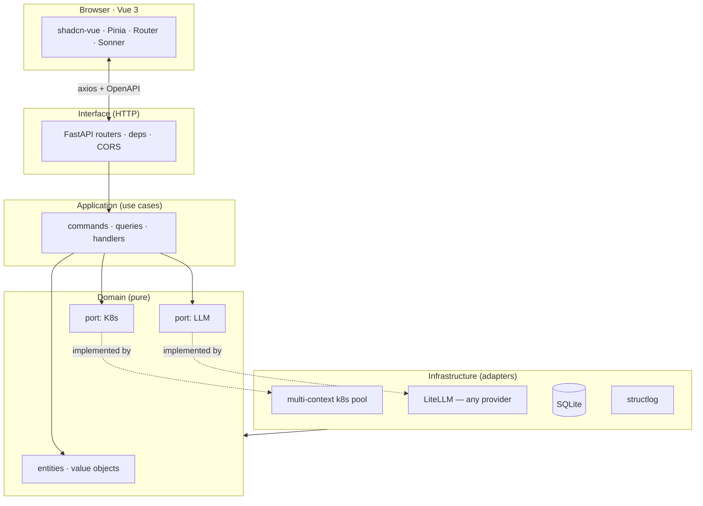

<div align="center">


<br/>

<a href="https://github.com/anomalyco/Spotlight/blob/main/LICENSE"></a>&nbsp;&nbsp;&nbsp;

<br/><br/>

<a href="./README.md"><b>English</b></a> &nbsp;·&nbsp;
<a href="./README.zh-CN.md">简体中文</a>

</div>

<br/>

##  &nbsp; The pitch

> **`kubectl`** tells you *what* is happening.<br/>
> **`Kubernetes Dashboard`** tells you *where* it is.<br/>
> **`Spotlight`** tells you ***why***.

Spotlight is an opinionated Kubernetes dashboard for the dev who *already* knows `kubectl`. It pulls every cluster in your kubeconfig into one view, streams Pod logs in real time, and hands the messy ones to an LLM **you pick** for an instant, contextual explanation — no SaaS, no vendor lock, your cluster, your data, your model.

<br/>

##  &nbsp; Three minutes to first signal

```bash
# Backend — FastAPI on :8002
cd backend && python -m venv .venv && source .venv/bin/activate
pip install -r requirements.txt && cp .env.example .env
uvicorn app.main:app --reload --port 8002

# Frontend — Vue 3 on :5173, in a second terminal
cd frontend && pnpm install && pnpm dev

# Open http://localhost:5173 — log in with any Bearer token
# (set API_TOKEN in backend/.env, or leave empty for local open mode)
```

> **Have Teleport?** Set `TELEPORT_PROXY` / `TELEPORT_AUTH` / `TELEPORT_CLUSTER` in `.env`. Spotlight issues per-session `tsh login` credentials — no kubeconfig needed.

<br/>

##  &nbsp; See it move

<div align="center">
  <table>
    <tr>
      <td align="center" width="50%"><br/><sub><b>Login</b> · Bearer / Teleport / Session</sub></td>
      <td align="center" width="50%"><br/><sub><b>Overview</b> · cluster health, pressure, signals</sub></td>
    </tr>
    <tr>
      <td align="center"><br/><sub><b>Pods</b> · live status, restart counts, namespace filter</sub></td>
      <td align="center"><br/><sub><b>AI Analyzer</b> · explain the last 200 lines, pick the model</sub></td>
    </tr>
  </table>
</div>

<br/>

##  &nbsp; AI in action

> Real output shape — pull up to 200 lines from any pod, click *Analyze*, pick a model:

```text
▸ AI · claude-3-5-sonnet · 1.42s · tokens 412 in / 286 out

  Root cause
    The pod is being OOMKilled. Container RSS hit the 512 MiB limit at
    17:42:08; the kernel sent SIGKILL (exit 137); Kubernetes restarted
    the container 21,320 times in the last 5 minutes.

  Evidence
    L17  "oom score adj = 950"
    L23  "memory.peak = 512MiB / limit 512MiB"
    L88  "loki-write: signal SIGKILL, exit code 137"

  Suggested fix
    • Raise memory.limit to 768 MiB in the Helm values, or
    • Drop WAL retention from 24h → 6h in the ingester config, or
    • Shard the tenant — split by labels across 3 replicas.
```

> [!TIP]
> The model is **swap-in**: change `AI_PROVIDER` in `.env`, save, pick a different model in the UI, no restart. The same call works against OpenAI, Anthropic, Bedrock, Gemini, Ollama, **or any OpenAI-compatible endpoint**.

<br/>

##  &nbsp; What it does, in one screen

| | |
|---|---|
| 🧭 **Multi-cluster kubeconfig, one UI** | Switch contexts live. The exact `KUBECONFIG` your shell already respects. |
| 📜 **Real-time log streaming (SSE)** | Multi-pod select, ANSI color preserved, dedup, download. |
| 🤖 **AI log analysis, any provider** | Bring your own key — OpenAI · Anthropic · Bedrock · Gemini · Ollama · 100+ via LiteLLM. |
| ⌨️ **Keyboard-first** | `⌘K` palette, `g d / p / n / e / f / a` to leap between pages, no mouse needed. |
| 🧱 **Pluggable auth** | Bearer token · session cookie · Teleport tsh · your own plugin (one file). |
| 🔍 **Type-safe, end-to-end** | Pydantic v2 → OpenAPI → `openapi-typescript`. Frontend can't drift from backend. |
| 🌑 **Appica design language** | Pure black `#18181B` on pure white `#FAFAFA`, 1 px borders, one accent gradient. |
| ♿ **Accessible by default** | axe-core in Playwright, keyboard-only flows verified, screen-reader semantics. |
| 🧪 **100 % testable** | Hexagonal architecture: every port is mocked, every adapter is tested, e2e covers the critical paths. |

<br/>

##  &nbsp; vs. the field

| | `kubectl` | Kubernetes Dashboard | Lens / OpenLens | **Spotlight** |
|---|---|---|---|---|
| Multi-cluster switch | `kubectx` | manual | ✔ | **✔ (live)** |
| Real-time log streaming | `kubectl logs -f` | ✔ | ✔ | **✔ (multi-pod + dedup)** |
| AI log explainer | ✗ | ✗ | ✗ | **✔ (any LLM)** |
| Pluggable auth | ✗ | ✗ | partial | **✔ (one-file plugin)** |
| Type-safe API → UI | ✗ | ✗ | ✗ | **✔ (Pydantic → TS)** |
| Self-hostable, no signup | ✔ | ✔ | partial | **✔** |
| SaaS / cloud lock-in | none | none | none | **none** |
| Opinionated, fast UI | ✗ | ✗ | partial | **✔ (Appica)** |

> Spotlight does not replace `kubectl`. It sits *on top* — gives you the dashboard, the trail, and the diagnosis, fast.

<br/>

##  &nbsp; How it's built

Spotlight is **Hexagonal / Clean Architecture** — the domain knows nothing about Kubernetes, AI, or HTTP; adapters do.



> **Adding a new auth provider, log source, or LLM?** Add an `infrastructure/<thing>/` adapter that implements the matching port, register it. Nothing else moves.

<br/>

##  &nbsp; AI providers, plug & play

LiteLLM under the hood — one env-var, swap any model.

| Provider | `AI_PROVIDER=` | What you set |
|---|---|---|
| **OpenAI** | `openai` | `OPENAI_API_KEY` |
| **Anthropic** | `anthropic` | `ANTHROPIC_API_KEY` |
| **Azure OpenAI** | `azure` | `AZURE_API_KEY` · `AZURE_API_BASE` · `AZURE_API_VERSION` |
| **AWS Bedrock** | `bedrock` | `AWS_ACCESS_KEY_ID` · `AWS_REGION` |
| **Google Gemini / Vertex** | `gemini` / `vertex` | `GEMINI_API_KEY` / `VERTEX_PROJECT` |
| **Ollama (local)** | `ollama` | `OLLAMA_API_BASE=http://host:11434` |
| **OpenRouter** | `openrouter` | `OPENROUTER_API_KEY` |
| **Any OpenAI-compatible API** | `custom` | `AI_API_BASE` · `AI_API_KEY` |

The **model** is picked from the UI — no restart needed.

<br/>

##  &nbsp; Stack

**Backend**
<a href="#"></a>
<a href="#"></a>
<a href="#"></a>
<a href="#"></a>
<a href="#"></a>
<a href="#"></a>

**Frontend**
<a href="#"></a>
<a href="#"></a>
<a href="#"></a>
<a href="#"></a>
<a href="#"></a>
<a href="#"></a>

**Tests**
<a href="#"></a>
<a href="#"></a>
<a href="#"></a>
<a href="#"></a>

**Infra**
<a href="#"></a>
<a href="#"></a>
<a href="#"></a>

<br/>

##  &nbsp; Project layout

```
Spotlight/
├── backend/                    # FastAPI — hexagonal / clean architecture
│   ├── app/
│   │   ├── application/        # commands · queries · handlers (use cases)
│   │   ├── domain/             # pure entities, value objects, ports
│   │   ├── infrastructure/     # adapters: k8s, db, logging, LLM, auth
│   │   ├── interface/api/      # FastAPI routers / DTOs
│   │   └── main.py             # app factory + lifespan
│   ├── tests/                  # pytest — unit + integration
│   └── requirements.txt
├── frontend/                   # Vue 3 + Vite + Tailwind + shadcn-vue
│   ├── src/
│   │   ├── components/         # ui/, layout/, common/, pod/, dashboard/, log/, ai/
│   │   ├── views/              # 8 pages (Login, Dashboard, Pods, PodDetail, …)
│   │   ├── stores/             # Pinia
│   │   ├── api/                # axios + openapi-typescript generated
│   │   └── styles/             # design tokens
│   └── package.json
├── assets/                     # brand banner, mark, README screenshots
├── docs/                       # local-only scratch — not git-tracked
├── LICENSE                     # MIT
├── README.md  ·  README.zh-CN.md
└── ...                         # config + tooling
```

<br/>

##  &nbsp; Roadmap

- [x] **v2.0** — multi-cluster kubeconfig, SSE log streaming, LiteLLM, Appica UI v6, hexagonal backend.
- [ ] **v2.1** — Helm chart deploy, single-binary mode, SQLite → Postgres migration path.
- [ ] **v2.2** — RBAC-aware views, multi-user session isolation, audit log UI.
- [ ] **v3.0** — Plugin SDK (third-party LLM analyzers, custom log parsers) + authenticated **public read-only share** links.

> Open a Discussion thread if a feature matters to you — the roadmap is shaped by what people actually use.

<br/>

##  &nbsp; Contributing

Any-size contributions are welcome — bug reports, docs, code, AI provider adapters.

```bash
git clone https://github.com/<you>/Spotlight.git && cd Spotlight

# Backend
cd backend && source .venv/bin/activate
pip install -r requirements.txt
pytest -q

# Frontend
cd ../frontend && pnpm install
pnpm test           # Vitest — unit
pnpm test:e2e       # Playwright — browser
```

> Per-package dev guide: [`backend/README.md`](./backend/README.md) · [`frontend/README.md`](./frontend/README.md)
> Architecture rule: **ports and adapters only** — `app/` never imports `kubernetes` or `litellm` directly.

<br/>

##  &nbsp; Health check

```
GET /healthz
{ "status": "ok" }
```

OpenAPI spec at `GET /openapi.json` · Swagger UI at `/docs`.

<br/>

##  &nbsp; Star history

<a href="https://star-history.com/#anomalyco/Spotlight&Timeline">
  <picture>
    <source media="(prefers-color-scheme: dark)" srcset="https://api.star-history.com/svg?repos=anomalyco/Spotlight&type=Timeline&theme=dark" />
    <source media="(prefers-color-scheme: light)" srcset="https://api.star-history.com/svg?repos=anomalyco/Spotlight&type=Timeline" />
    
  </picture>
</a>

<br/>

##  &nbsp; License

[MIT](./LICENSE) — do anything, just keep the copyright.

<br/>

##  &nbsp; Acknowledgements

Spotlight rides on an enormous open-source ecosystem. The names that show up in the dependency graph most: **FastAPI**, **Pydantic**, **SQLAlchemy**, **LiteLLM**, **kubernetes-python**, **Vue 3**, **Vite**, **Tailwind CSS**, **shadcn-vue**, **Radix Vue**, **Pinia**, **Lucide**, **Axios**, **Playwright**, **Vitest**, **pytest**, **structlog**.

<br/>

<div align="center">


<br/>

<sub>Spotlight · built for the dev who already knows kubectl.</sub>

</div>
