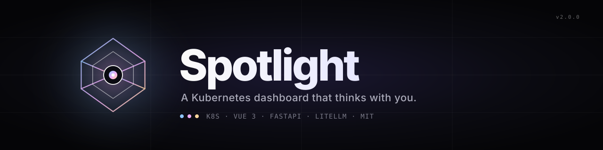
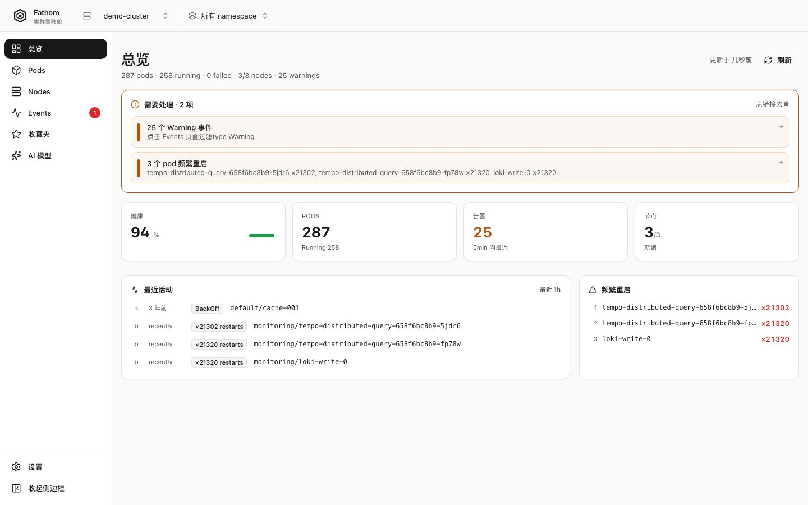
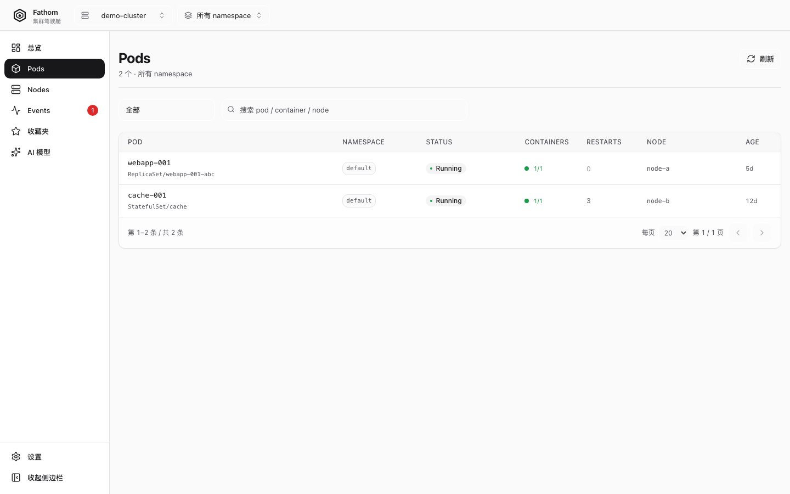
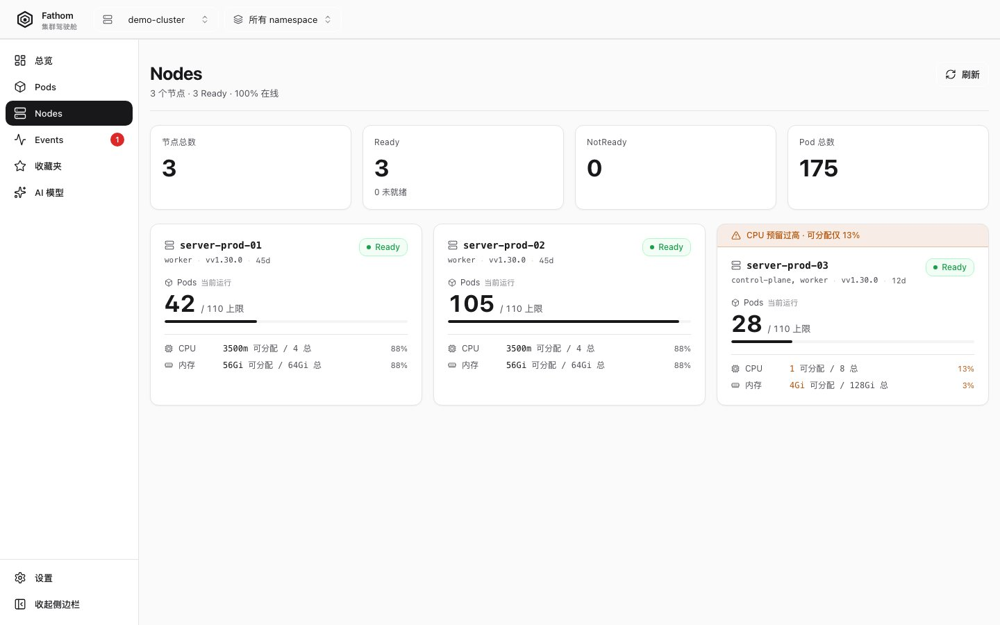
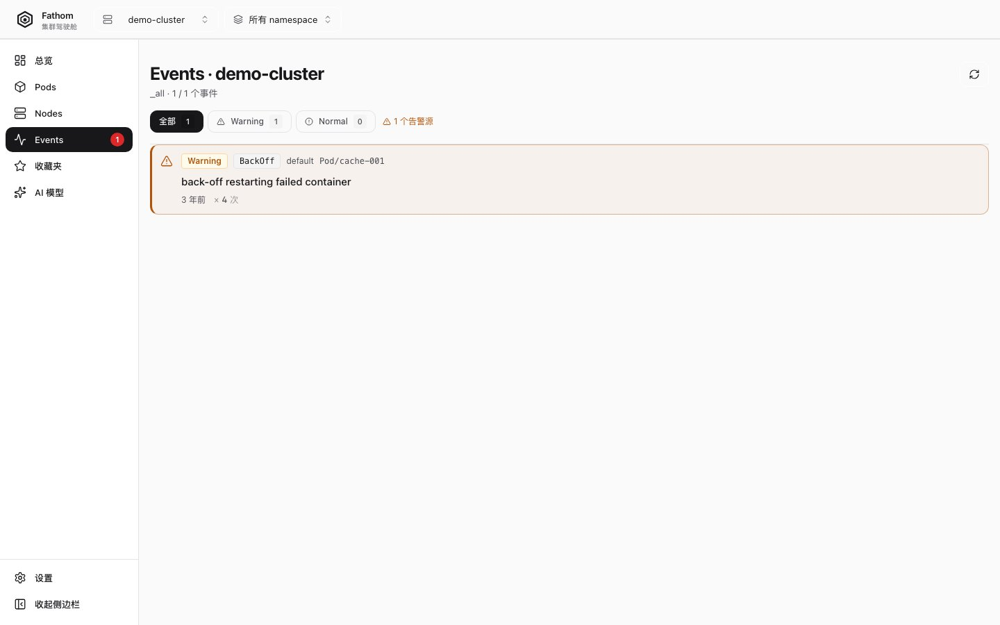
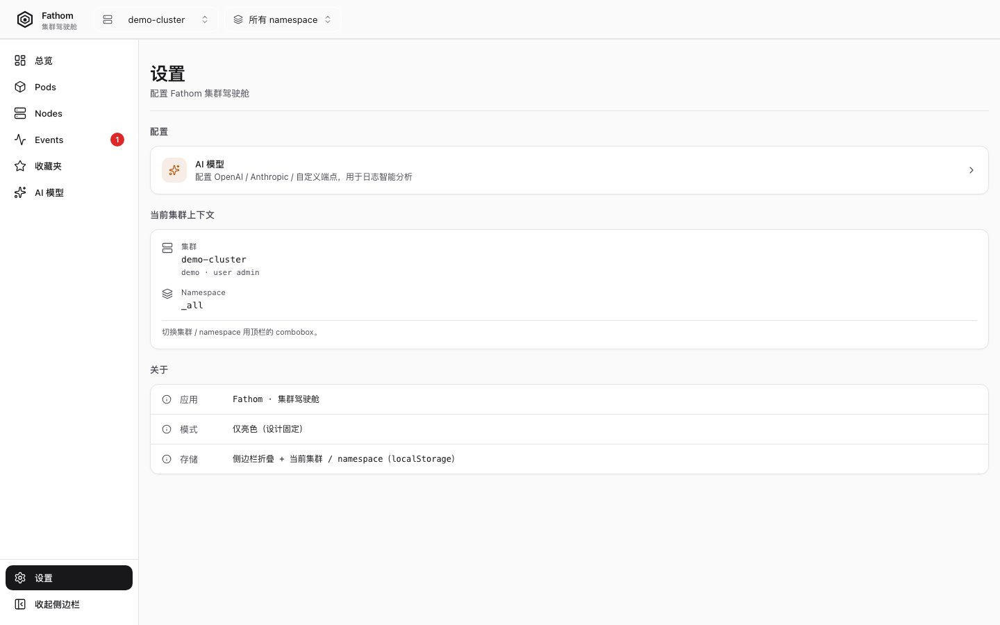

<div align="center">



<br/>

**Real-time Kubernetes visibility &nbsp;·&nbsp; AI-powered log analysis &nbsp;·&nbsp; Multi-cluster, multi-cloud, one pane of glass.**

<br/>

<a href="https://github.com/anomalyco/Spotlight/blob/master/LICENSE"></a>
&nbsp;

&nbsp;

&nbsp;

&nbsp;


<br/>

<a href="./README.md">English</a> &nbsp;·&nbsp;
<a href="./README.zh-CN.md">简体中文</a>

<br/><br/>

</div>

---

## ✨ Why Spotlight?

You ship to Kubernetes. You watch it run. You dig through logs until 2 a.m. to figure out **why**.

Spotlight gives that loop a copilot.

It is an **opinionated Kubernetes dashboard** that pulls together every cluster in your kubeconfig, renders pod logs in real time, and hands the messy ones to an LLM of *your* choice for an instant, contextual explanation. It is small, fast, type-safe end-to-end, and refuses to be a cloud-locked SaaS — your cluster, your data, your model.

> kubectl tells you *what* is happening.
> The Kubernetes Dashboard tells you *what is where*.
> **Spotlight tells you *why*.**

<br/>

## 📸 At a glance

<div align="center">
  
  <br/>
  <sub>The default <strong>Overview</strong> — cluster health, resource pressure, recent events, all on one screen.</sub>
</div>

<br/>

## ⚡ Quick start

**Spotlight is two processes. Run them, point them at your kubeconfig, open `http://localhost:5173`.**

```bash
# 1. Backend (FastAPI · port 8002)
cd backend
python -m venv .venv && source .venv/bin/activate
pip install -r requirements.txt
cp .env.example .env
uvicorn app.main:app --reload --port 8002

# 2. Frontend (Vue 3 · port 5173) — in a second terminal
cd frontend
pnpm install
pnpm dev
```

Then open **<http://localhost:5173>** and log in with any `Authorization: Bearer <token>` set in `backend/.env` as `API_TOKEN=<your-token>` — or leave it empty for local open mode (a startup warning confirms the choice).

> **Have Teleport?** Set `TELEPORT_PROXY`, `TELEPORT_AUTH`, and `TELEPORT_CLUSTER` in `.env` and Spotlight will issue per-session `tsh login` credentials. No kubeconfig needed.

<br/>

## 🔦 Features

| | |
|---|---|
| 🧭 **Multi-cluster kubeconfig in one UI** | Switch contexts live without restarting. The exact same `KUBECONFIG` your shell already respects. |
| 📜 **Real-time log streaming (SSE)** | Multi-pod selection, ANSI color preserved, deduplicated groups, download to file. |
| 🤖 **AI log analysis, any provider** | Bring your own key — OpenAI · Anthropic · Bedrock · Gemini · Ollama · 100+ via **LiteLLM**. |
| ⌨️ **Keyboard-first navigation** | `⌘K` command palette, `g d / p / n / e / f / a` page jumps, built for terminal reflexes. |
| 🧱 **Pluggable auth** | Bearer token · session cookie · Teleport tsh · your own plugin (interface is one file). |
| 🔍 **Type-safe end-to-end** | Pydantic v2 → OpenAPI → `openapi-typescript`. The frontend cannot drift from the backend. |
| 🌑 **Appica design language** | Pure black `#18181B` on pure white `#FAFAFA`, 1 px borders, one accent gradient. No skeuomorphic noise. |
| ♿ **Accessible by default** | axe-core in Playwright, keyboard-only flows verified, screen-reader structure. |
| 🧪 **100 % testable** | Hexagonal architecture: every port is mocked, every adapter is tested, e2e covers the critical paths. |

<br/>

## ⚖️ Spotlight vs the field

| | `kubectl` | Kubernetes Dashboard | Lens / OpenLens | **Spotlight** |
|---|---|---|---|---|
| Multi-cluster switch | `kubectx` | manual | ✔ | **✔ (live)** |
| Real-time log streaming | `kubectl logs -f` | ✔ | ✔ | **✔ (multi-pod + dedup)** |
| AI log explainer | ✗ | ✗ | ✗ | **✔ (any LLM)** |
| Pluggable auth | ✗ | ✗ | partial | **✔ (one-file plugin)** |
| Type-safe API → UI | ✗ | ✗ | ✗ | **✔ (Pydantic → TS)** |
| Self-hostable, no signup | ✔ | ✔ | partial | **✔** |
| Cloud / SaaS lock-in | none | none | none | **none** |
| Opinionated, fast UI | ✗ | ✗ | partial | **✔ (Appica)** |

> *Spotlight does not replace `kubectl`. It is the layer on top that shows you the dashboard, the trail, and the diagnosis — fast.*

<br/>

## 🖼 Screenshots

<div align="center">
  <table>
    <tr>
      <td align="center" width="50%">
        
        <br/><sub><b>Login</b> · bearer / Teleport / session</sub>
      </td>
      <td align="center" width="50%">
        
        <br/><sub><b>Overview</b> · cluster health at a glance</sub>
      </td>
    </tr>
    <tr>
      <td align="center">
        
        <br/><sub><b>Pods</b> · live status, restart counts, namespace filter</sub>
      </td>
      <td align="center">
        
        <br/><sub><b>AI Analyzer</b> · explain the last 200 lines, pick the model</sub>
      </td>
    </tr>
    <tr>
      <td align="center">
        
        <br/><sub><b>Nodes</b> · capacity, pressure, allocatable</sub>
      </td>
      <td align="center">
        
        <br/><sub><b>Events</b> · warning / normal timeline</sub>
      </td>
    </tr>
    <tr>
      <td align="center" colspan="2">
        
        <br/><sub><b>Settings</b> · AI provider, log preferences, kubeconfig source</sub>
      </td>
    </tr>
  </table>
</div>

<br/>

## 🧬 Architecture

Spotlight is a **Hexagonal / Clean Architecture** service. The domain knows nothing about Kubernetes, AI, or HTTP — adapters do.

```
                ┌─────────────────────────────────────────────────┐
                │                   Browser (Vue 3)               │
                │  shadcn-vue · Pinia · Vue Router · vue-sonner   │
                └─────────────┬──────────────────────┬────────────┘
                              │  axios + OpenAPI      │  SSE
                              │  (type-safe)          │  (real-time)
                              ▼                      ▼
        ┌──────────────────────────────────────────────────────────┐
        │                    Interface (HTTP)                       │
        │     FastAPI routers · middleware · CORS · deps           │
        └──────────────────────────┬───────────────────────────────┘
                                   ▼
        ┌──────────────────────────────────────────────────────────┐
        │                  Application (use cases)                  │
        │   commands · queries · handlers · CQRS-style dispatch     │
        └──────────────────────────┬───────────────────────────────┘
                                   ▼
        ┌──────────────────────────────────────────────────────────┐
        │                     Domain (pure)                          │
        │      entities · value objects · domain services           │
        └────────────┬──────────────────────────┬──────────────────┘
                     ▼                          ▼
        ┌────────────────────────┐  ┌─────────────────────────────┐
        │   k8s adapter port     │  │   LLM adapter port          │
        │   (kubernetes-python)  │  │   (LiteLLM — any provider)  │
        └────────────────────────┘  └─────────────────────────────┘
                     │                          │
                     ▼                          ▼
        ┌────────────────────────┐  ┌─────────────────────────────┐
        │  Multi-context pool    │  │  OpenAI · Anthropic · Bedrock│
        │  live kubeconfig watch │  │  Gemini · Ollama · +100 …    │
        └────────────────────────┘  └─────────────────────────────┘
```

> **Want to add a new auth provider, log source, or LLM?** Add an `infrastructure/<thing>/` adapter that implements the port, register it in the registry. Nothing else moves.

<br/>

## 🤖 AI providers, plug & play

Powered by **LiteLLM** — every provider is one env-var change away.

| Provider | Set `AI_PROVIDER=` | Extra config |
|---|---|---|
| **OpenAI** | `openai` | `OPENAI_API_KEY` |
| **Anthropic** | `anthropic` | `ANTHROPIC_API_KEY` |
| **Azure OpenAI** | `azure` | `AZURE_API_KEY` · `AZURE_API_BASE` · `AZURE_API_VERSION` |
| **AWS Bedrock** | `bedrock` | `AWS_ACCESS_KEY_ID` · `AWS_REGION` |
| **Google Gemini / Vertex** | `gemini` / `vertex` | `GEMINI_API_KEY` / `VERTEX_PROJECT` |
| **Ollama (local)** | `ollama` | `OLLAMA_API_BASE=http://host:11434` |
| **OpenRouter** | `openrouter` | `OPENROUTER_API_KEY` |
| **Anything else** | `custom` | `AI_API_BASE` · `AI_API_KEY` |

Set the **model** from the UI — no restart needed.

<br/>

## 🛠 Tech stack

<table>
  <tr>
    <td><b>Backend</b></td>
    <td>
      
      
      
      
      
      
    </td>
  </tr>
  <tr>
    <td><b>Frontend</b></td>
    <td>
      
      
      
      
      
      
    </td>
  </tr>
  <tr>
    <td><b>Tests</b></td>
    <td>
      
      
      
      
    </td>
  </tr>
  <tr>
    <td><b>Infra</b></td>
    <td>
      
      
      
    </td>
  </tr>
</table>

<br/>

## 🗺 Roadmap

- [x] **v2.0** — Multi-cluster kubeconfig, SSE log streaming, LiteLLM AI provider, Appica UI v6, hexagonal backend.
- [ ] **v2.1** — Helm chart deploy, one-binary mode, embedded SQLite migration to Postgres.
- [ ] **v2.2** — RBAC-aware views, multi-user session isolation, audit log UI.
- [ ] **v3.0** — Plugin SDK (third-party LLM analyzers, custom log parsers), and an authenticated **public read-only share** link.

> Open a discussion thread if a feature matters to you — the roadmap is shaped by what people actually use.

<br/>

## 🧑‍💻 Contributing

Contributions of any size are welcome — bug reports, docs, code, AI provider adapters.

```bash
# Fork, then:
git clone https://github.com/<you>/Spotlight.git && cd Spotlight

# Backend tests
cd backend && source .venv/bin/activate
pytest -q

# Frontend tests (Vitest + Playwright)
cd ../frontend && pnpm install
pnpm test           # unit
pnpm test:e2e       # browser
```

> See [`backend/README.md`](./backend/README.md) and [`frontend/README.md`](./frontend/README.md) for the per-package dev guide. Architecture rules — short version: **ports and adapters only**, no leaking of `kubernetes` or `litellm` types into `app/`.

<br/>

## 🩻 Health

Spotlight exposes a tiny `/healthz` so probes and dashboards can see it:

```
GET /healthz
{ "status": "ok" }
```

The OpenAPI spec lives at `GET /openapi.json` and the Swagger UI at `/docs`.

<br/>

## 📐 Project layout

```
Spotlight/
├── backend/                  # FastAPI app — hexagonal / clean architecture
│   ├── app/
│   │   ├── application/      # commands, queries, handlers (use cases)
│   │   ├── domain/           # pure entities, value objects, ports
│   │   ├── infrastructure/   # adapters: k8s, db, logging, LLM, auth
│   │   ├── interface/api/    # FastAPI routers / DTOs
│   │   └── main.py
│   ├── tests/                # pytest — unit + integration
│   └── requirements.txt
├── frontend/                 # Vue 3 + Vite + Tailwind + shadcn-vue
│   ├── src/
│   │   ├── components/       # ui/, layout/, common/, pod/, dashboard/, log/, ai/
│   │   ├── views/            # Login, Dashboard, Pods, PodDetail, Nodes, Events, AI, Settings, Favorites
│   │   ├── stores/           # Pinia
│   │   ├── api/              # axios + openapi-typescript generated client
│   │   └── styles/           # design tokens
│   └── package.json
├── docs/                     # architecture, screenshot assets, this README
├── banner.svg / logo.svg     # brand assets
└── README.md / README.zh-CN.md
```

<br/>

## ⭐ Star history

<a href="https://star-history.com/#anomalyco/Spotlight&Timeline">
  <picture>
    <source media="(prefers-color-scheme: dark)" srcset="https://api.star-history.com/svg?repos=anomalyco/Spotlight&type=Timeline&theme=dark" />
    <source media="(prefers-color-scheme: light)" srcset="https://api.star-history.com/svg?repos=anomalyco/Spotlight&type=Timeline" />
    
  </picture>
</a>

<br/>

## 📝 License

[MIT](./LICENSE) — do anything, just keep the copyright.

<br/>

## 🙏 Acknowledgements

Spotlight is built on the shoulders of an enormous open-source ecosystem. The names that show up in the dep graph most: **FastAPI**, **Pydantic**, **SQLAlchemy**, **LiteLLM**, **kubernetes-python**, **Vue 3**, **Vite**, **Tailwind CSS**, **shadcn-vue**, **Radix Vue**, **Pinia**, **Lucide**, **Axios**, **Playwright**, **Vitest**, **pytest**, **structlog**.

<br/>

<div align="center">

<sub>Spotlight · built for the dev who already knows kubectl.</sub>

<br/>

<a href="#-why-spotlight">⇡ back to top</a>

</div>
