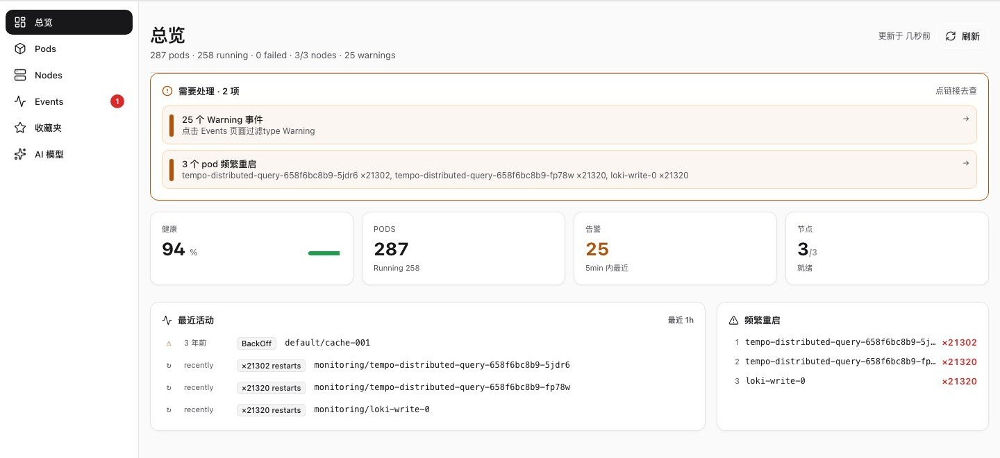
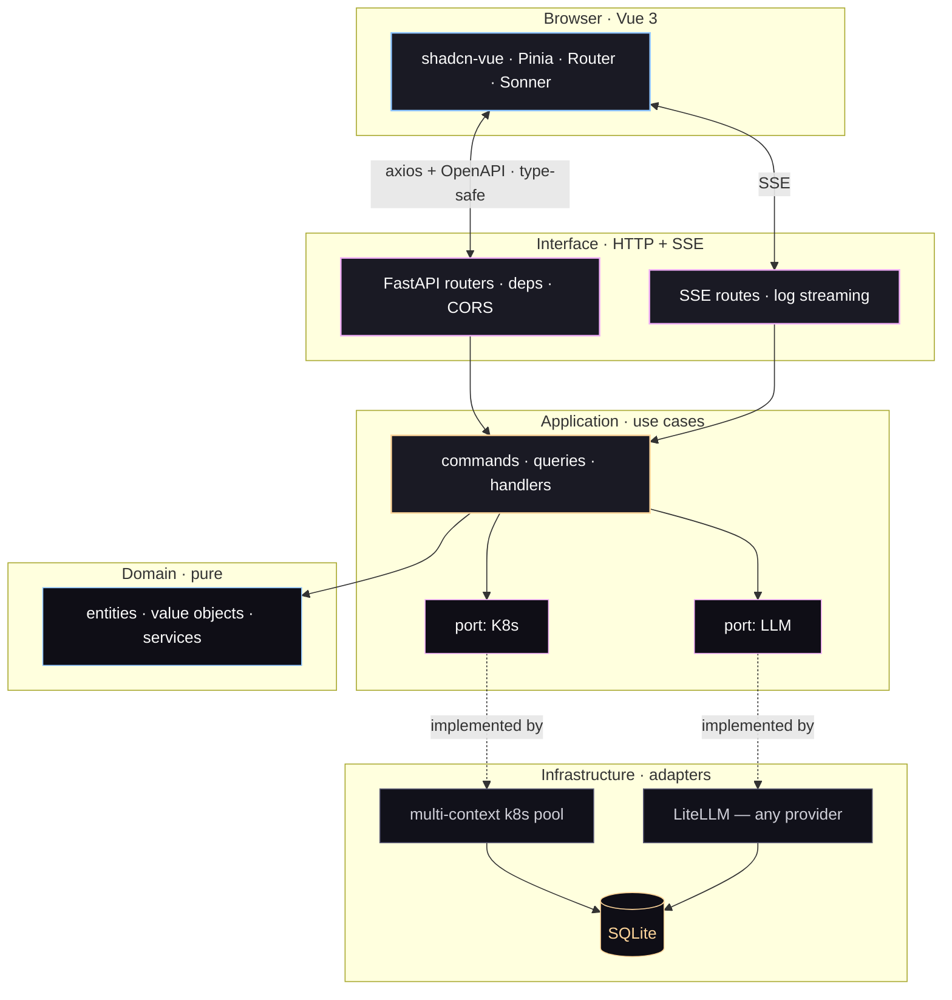

<div align="center">


<br/>

**给已经会 `kubectl` 的开发者的 K8s 仪表盘 —— 它会思考。**

<br/>

<a href="#-快速开始"></a>&nbsp;
<a href="https://github.com/mcgrapeng/Spotlight/discussions"></a>&nbsp;
<a href="https://github.com/sponsors/mcgrapeng"></a>

<br/>

<a href="./README.md">English</a> &nbsp;·&nbsp; <a href="./README.zh-CN.md"><b>简体中文</b></a>

<br/>


</div>

## 📸 界面



<sub>kubeconfig 里的每个 context 都在一屏之内：健康度、压力，以及那些解释了你凌晨三点的重启次数。</sub>

## 🎯 为什么

`kubectl` 告诉你**正在发生什么**。
Kubernetes Dashboard 告诉你它**在哪里**。
**Spotlight** 告诉你***为什么***。

> 我们在凌晨两点排查一次线上故障。那个 Pod 在崩溃重启，`kubectl logs` 显示 21,320 次重启，Dashboard 却在兴高采烈地报告它 "Running"。两个都没说为什么 —— 那行 `OOMKilled` 埋在 200 行日志的第 88 行。这个缺口，*只有仪表盘、没有诊断*，就是 Spotlight 要补的。

没有 SaaS，没有厂商锁定。你的集群、你的数据、你的模型。

## ✨ 核心能力

- **多集群，一个界面** —— kubeconfig 里的每个 context 都能实时切换，不用重启。
- **实时日志流** —— SSE、多 Pod 选择、保留 ANSI 颜色、自动去重、可下载。
- **AI 解读，任意模型** —— OpenAI · Anthropic · Bedrock · Gemini · Ollama · 经 LiteLLM 支持 100+ 家。
- **键盘优先** —— `⌘K` 命令面板，`g d/p/n/e/f/a` 页面跳转，不碰鼠标也能用。
- **鉴权可插拔** —— bearer · session · Teleport `tsh` · 或者你自己写一个插件，一个文件的事。
- **端到端类型安全** —— Pydantic v2 → OpenAPI → `openapi-typescript`，前端不可能和 API 脱节。

## 🚀 快速开始

两个进程：FastAPI 在 `:8002`，Vue 在 `:5173`。

```bash
# 1 · 后端
cd backend
python -m venv .venv && source .venv/bin/activate
pip install -r requirements.txt
cp .env.example .env
uvicorn app.main:app --reload --port 8002
```

```bash
# 2 · 前端 —— 另开一个终端
cd frontend
pnpm install
pnpm dev
```

打开 <http://localhost:5173>。

<details>
<summary>鉴权、Teleport，以及把 API 锁起来</summary>

本地开发时把 `API_TOKEN` 和 `TELEPORT_*` 留空即可 —— API 会以开放状态启动，并打印一条启动告警。要开启鉴权，在 `backend/.env` 里设 `API_TOKEN=<你的 token>`，然后用任意 `Authorization: Bearer <token>` 登录。

**在用 Teleport？** 在 `.env` 里设 `TELEPORT_PROXY`、`TELEPORT_AUTH`、`TELEPORT_CLUSTER`。Spotlight 会签发按会话生效的 `tsh login` 凭据，完全不需要 kubeconfig。

**想自己写鉴权插件？** 在 `backend/app/infrastructure/auth/plugins/` 实现 `AuthPlugin`，在该包的 `REGISTRY` 里注册，然后设 `AUTH_PROVIDER=<你的插件 id>`。登录表单会依据插件的 `form_fields()` 自动适配。

</details>

## ⚖️ 横向对比

| | `kubectl` | Dashboard | Lens | **Spotlight** |
|---|:---:|:---:|:---:|:---:|
| 多集群实时切换 | 靠 `kubectx` | 手动 | 支持 | **支持** |
| 多 Pod 实时日志流 | `-f` | 支持 | 支持 | **支持，自动去重** |
| AI 日志解读 | — | — | — | **支持，任意 LLM** |
| 鉴权可插拔 | — | — | 部分 | **支持，一个文件** |
| API → UI 类型安全 | — | — | — | **支持，Pydantic → TS** |

> Spotlight 不是用来替代 `kubectl` 的。它叠加在其上 —— 并给出诊断。

## 🤖 AI 实测

从任意 Pod 拉取最近 200 行日志，点 **Analyze**，选一个模型：

```text
▸ AI · claude-3-5-sonnet · 1.42s · tokens 412 in / 286 out

  Root cause
    The pod is being OOMKilled. Container RSS hit the 512 MiB limit at
    17:42:08; the kernel sent SIGKILL (exit 137); Kubernetes restarted
    the container 21,320 times in the last 5 minutes.

  Evidence
    L17  "oom score adj = 950"
    L23  "memory.peak = 512MiB / limit 512MiB"
    L88  "loki-write: signal SIGKILL, exit code 137"

  Suggested fix
    • Raise memory.limit to 768 MiB in the Helm values, or
    • Drop WAL retention from 24h → 6h in the ingester config, or
    • Shard the tenant — split by labels across 3 replicas.
```

提供商配置存在 SQLite（`ai_providers` 表），完全通过 **设置 → AI** 管理。没有 `AI_PROVIDER` 环境变量 —— 切换模型是一个 UI 动作，不重启、不重建。

## 🏗️ 架构

六边形架构。领域层和应用层不认识 Kubernetes、HTTP 或 LLM，这些都交给基础设施适配器。



**一条规则：** `domain/` 和 `application/` 永不直接 import `kubernetes` 或 `litellm`。一切都通过 `application/ports/` 声明的 port。要加一个鉴权提供商、一个 LLM 或一个日志源 —— 在 `infrastructure/` 实现对应适配器并注册，别的一行都不用动。

**技术栈** —— 后端：FastAPI · Pydantic v2 · kubernetes-python · LiteLLM · SQLAlchemy（async + aiosqlite）· structlog。前端：Vue 3 · Vite · Tailwind CSS · shadcn-vue · Pinia · axios。测试：pytest · Vitest · Playwright · axe-core。

## 🗺️ 路线图

- [x] **v2.0** —— 多集群 kubeconfig、SSE 日志流、LiteLLM、UI v6、六边形后端
- [ ] **v2.1** —— Helm chart · 单二进制模式 · SQLite → Postgres
- [ ] **v2.2** —— RBAC 感知的视图 · 多用户会话隔离 · 审计日志界面
- [ ] **v3.0** —— 插件 SDK · 带鉴权的公开只读分享链接

如果你有在意的能力，开个 [Discussion](https://github.com/mcgrapeng/Spotlight/discussions) —— 路线图是跟着真实使用走的。

## 📚 更多

<details>
<summary><b>能上生产吗？</b></summary>

除 AI 解读外，可以。v2.0 具备六边形架构、强类型 API 契约、SSE 日志流，以及覆盖关键 port 的测试套件。AI 解读是唯一会访问外部 LLM 的功能，其余部分完全离线运行。

</details>

<details>
<summary><b>和 Lens、k9s 有什么区别？</b></summary>

Lens 是一个完整的 Kubernetes IDE —— 探索资源很顺手，但没有 AI 日志解读。k9s 是终端 UI —— 快且极简，但不是 Web 仪表盘。Spotlight 是中间那一档：带 AI 诊断的 Web 仪表盘。见[横向对比](#-横向对比)。

</details>

<details>
<summary><b>能用我自己的推理端点吗？</b></summary>

能。**设置 → AI → 添加 Provider → custom**，然后粘贴任意 OpenAI 兼容端点的 base URL（Ollama、vLLM、LM Studio 都可以）。模型名在同一张表单里填。配置存进 SQLite，下次调用直接生效 —— 不用重启。

</details>

<details>
<summary><b>它会存我的集群凭据吗？</b></summary>

不会。Spotlight 只在运行时读取你的 `KUBECONFIG`，从不持久化集群凭据。`API_TOKEN` 放在 `backend/.env`（已在 gitignore 中）。Teleport 会话按会话签发且会过期。

</details>

<details>
<summary><b>有 Docker 镜像吗？</b></summary>

暂时没有 —— Helm chart 和单二进制模式在 v2.1 路线图上。目前请直接跑那两个进程，见[快速开始](#-快速开始)。

</details>

<details>
<summary><b>参与贡献</b></summary>

任何规模的贡献都欢迎 —— 修 bug、写文档、写代码、加 provider 适配器。

```bash
git clone https://github.com/mcgrapeng/Spotlight.git && cd Spotlight

cd backend && python -m venv .venv && source .venv/bin/activate
pip install -r requirements.txt && pytest -q

cd ../frontend && pnpm install
pnpm test         # Vitest
pnpm test:e2e     # Playwright
```

类型检查需要后端在跑，因为它读 `/openapi.json`：

```bash
cd frontend && pnpm types:check
```

分包开发指南：[`backend/README.md`](./backend/README.md) · [`frontend/README.md`](./frontend/README.md)

</details>

<details>
<summary><b>仓库结构</b></summary>

```text
Spotlight/
├── backend/                   FastAPI · 六边形架构
│   ├── app/
│   │   ├── application/       用例 + port
│   │   ├── domain/            实体 · 值对象 · 领域服务
│   │   ├── infrastructure/    适配器：ai, auth, cache, config, k8s, logging, persistence
│   │   ├── interface/         api/（路由 · DTO）+ sse/
│   │   └── main.py
│   ├── tests/                 pytest —— 单元 + 集成
│   └── requirements.txt
├── frontend/                  Vue 3 + Vite + Tailwind + shadcn-vue
│   ├── src/
│   │   ├── components/        ui/, layout/, common/, pod/, dashboard/, log/, ai/
│   │   ├── views/             9 个页面
│   │   ├── stores/            Pinia
│   │   ├── api/               axios + 生成的 OpenAPI 类型
│   │   └── styles/            设计 token
│   └── package.json
├── assets/                    logo lockup、README 截图
├── LICENSE                    MIT
└── README.md · README.zh-CN.md
```

</details>

## ⭐ 星标增长

<div align="center">

<a href="https://star-history.com/#mcgrapeng/Spotlight&Date">
  <picture>
    <source media="(prefers-color-scheme: dark)" srcset="https://api.star-history.com/svg?repos=mcgrapeng/Spotlight&type=Date&theme=dark" />
    <source media="(prefers-color-scheme: light)" srcset="https://api.star-history.com/svg?repos=mcgrapeng/Spotlight&type=Date" />
    
  </picture>
</a>

</div>

---

<div align="center">

MIT © Spotlight contributors

<br/>

<a href="https://github.com/mcgrapeng/Spotlight/discussions">Discussions</a> &nbsp;·&nbsp;
<a href="https://github.com/mcgrapeng/Spotlight/issues">Issues</a> &nbsp;·&nbsp;
<a href="https://github.com/mcgrapeng/Spotlight/releases">Releases</a> &nbsp;·&nbsp;
<a href="https://github.com/sponsors/mcgrapeng">Sponsor</a>

</div>
