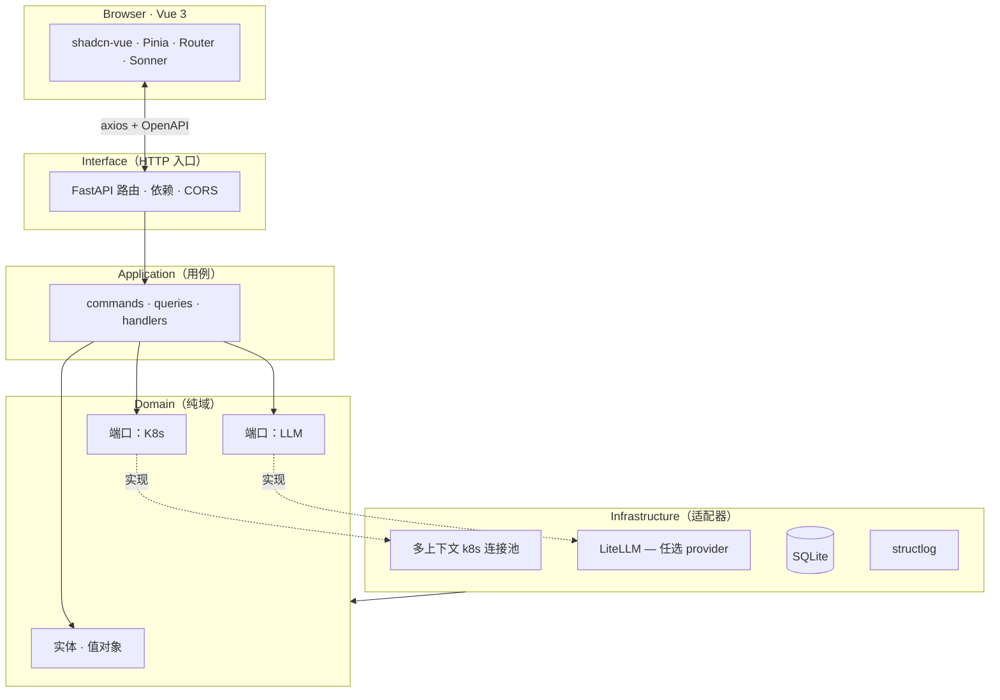

<div align="center">


<br/>

<a href="https://github.com/anomalyco/Spotlight/blob/main/LICENSE"></a>&nbsp;&nbsp;&nbsp;

<br/><br/>

<a href="./README.zh-CN.md"><b>简体中文</b></a> &nbsp;·&nbsp;
<a href="./README.md">English</a>

</div>

<br/>

##  &nbsp; 一句话

> **`kubectl`** 告诉你 **发生了什么**。<br/>
> **`Kubernetes Dashboard`** 告诉你 **东西在哪**。<br/>
> **`Spotlight`** 告诉你 **为什么**。

Spotlight 是给「已经会用 `kubectl` 的人」准备的、有主张的 Kubernetes 驾驶舱：把你 `kubeconfig` 里所有集群收进同一个界面，实时流式拉取 Pod 日志，再把乱七八糟的内容交给**你自己选的**大模型，要一份带上下文的解释。它不开云端 SaaS，不锁定供应商——你的集群、你的数据、你的模型。

<br/>

##  &nbsp; 三分钟跑起来

```bash
# 后端 — FastAPI，:8002
cd backend && python -m venv .venv && source .venv/bin/activate
pip install -r requirements.txt && cp .env.example .env
uvicorn app.main:app --reload --port 8002

# 前端 — Vue 3，:5173（另开一个终端）
cd frontend && pnpm install && pnpm dev

# 打开 http://localhost:5173 — 用任意 Bearer 令牌登录
# 在 backend/.env 里设 API_TOKEN=xxx；留空则是本地开放模式（启动会有告警）
```

> **用 Teleport？** 在 `.env` 里设 `TELEPORT_PROXY` / `TELEPORT_AUTH` / `TELEPORT_CLUSTER`，Spotlight 会按会话去签发 `tsh login` 凭证——不需要本地 kubeconfig。

<br/>

##  &nbsp; 看它动起来

<div align="center">
  <table>
    <tr>
      <td align="center" width="50%"><br/><sub><b>登录</b> · Bearer / Teleport / Session</sub></td>
      <td align="center" width="50%"><br/><sub><b>Overview</b> · 集群健康、压力、信号一眼看完</sub></td>
    </tr>
    <tr>
      <td align="center"><br/><sub><b>Pods</b> · 实时状态、重启计数、命名空间筛选</sub></td>
      <td align="center"><br/><sub><b>AI 分析器</b> · 最后 200 行，挑模型，让他解释</sub></td>
    </tr>
  </table>
</div>

<br/>

##  &nbsp; AI 是怎么工作的

> 真实输出长这样——任选一个 Pod，抓 200 行日志，点 *Analyze*，挑模型：

```text
▸ AI · claude-3-5-sonnet · 1.42s · tokens 412 in / 286 out

  根因
    这是一个 OOMKill。容器 RSS 在 17:42:08 触顶 512 MiB，
    内核发送 SIGKILL（exit 137），最近 5 分钟被 Kubernetes
    重启了 21,320 次。

  证据
    L17  "oom score adj = 950"
    L23  "memory.peak = 512MiB / limit 512MiB"
    L88  "loki-write: signal SIGKILL, exit code 137"

  处理建议
    • 把 memory.limit 提到 768 MiB（在 Helm values 里），或
    • 把 ingester 的 WAL 保留时间从 24h 砍到 6h，或
    • 把租户切片——按 label 拆到 3 个副本上。
```

> [!TIP]
> **模型可以热换**：改 `.env` 里的 `AI_PROVIDER`，保存，UI 里换模型，**不用重启**。同样的调用对 OpenAI、Anthropic、Bedrock、Gemini、Ollama，以及**任何兼容 OpenAI 的端点**都生效。

<br/>

##  &nbsp; 这一屏，全特性

| | |
|---|---|
| 🧭 **多集群 kubeconfig，一块屏幕** | 沿用 shell 已有的 `KUBECONFIG`，热切换 context，无需重启。 |
| 📜 **实时日志（SSE 流）** | 多 Pod 选、ANSI 颜色保留、分组去重、一键下载。 |
| 🤖 **AI 日志分析，模型自选** | 自带 Key——OpenAI · Anthropic · Bedrock · Gemini · Ollama · 通过 LiteLLM 支持 100+。 |
| ⌨️ **键盘先行** | `⌘K` 命令面板 · `g d / p / n / e / f / a` 跳转页面，鼠标可以不用。 |
| 🧱 **可插拔鉴权** | Bearer · Session · Teleport tsh · 你自己的插件（一个文件）。 |
| 🔍 **端到端强类型** | Pydantic v2 → OpenAPI → `openapi-typescript`，前后端不会偷偷漂移。 |
| 🌑 **Appica 设计语言** | 纯黑 `#18181B` · 纯白 `#FAFAFA` · 1 px 描边 · 一道装饰渐变。 |
| ♿ **默认无障碍** | Playwright 内置 axe-core，全键盘可达、屏幕阅读器结构化。 |
| 🧪 **可测到 100 %** | 六边形架构：每个端口可 mock，每个适配器可测，e2e 覆盖关键路径。 |

<br/>

##  &nbsp; 和熟悉工具的对比

| | `kubectl` | Kubernetes Dashboard | Lens / OpenLens | **Spotlight** |
|---|---|---|---|---|
| 多集群切换 | `kubectx` | 手动 | ✔ | **✔（实时）** |
| 实时日志流 | `kubectl logs -f` | ✔ | ✔ | **✔（多 Pod + 去重）** |
| AI 日志解读 | ✗ | ✗ | ✗ | **✔（任选模型）** |
| 可插拔鉴权 | ✗ | ✗ | 有限 | **✔（一个文件）** |
| API → UI 强类型 | ✗ | ✗ | ✗ | **✔（Pydantic → TS）** |
| 自托管、无注册 | ✔ | ✔ | 有限 | **✔** |
| 云 / SaaS 锁定 | 无 | 无 | 无 | **无** |
| 有主张、跑得快 | ✗ | ✗ | 有限 | **✔（Appica）** |

> Spotlight 不替代 `kubectl`。它位于其上——给你看一眼仪表盘、看一眼时间线、看一眼诊断。

<br/>

##  &nbsp; 它怎么造的

Spotlight 是**六边形 / Clean Architecture** 服务。Domain 不知道 Kubernetes、AI 或 HTTP——那是适配器的事。



> **想加一种新的鉴权方式、日志源或 LLM？** 在 `infrastructure/<thing>/` 加一个实现端口的适配器，注册到注册表，其它啥都不用动。

<br/>

##  &nbsp; AI 提供商，即插即用

底层是 **LiteLLM** —— 一个环境变量就能切。

| 提供商 | `AI_PROVIDER=` | 额外配置 |
|---|---|---|
| **OpenAI** | `openai` | `OPENAI_API_KEY` |
| **Anthropic** | `anthropic` | `ANTHROPIC_API_KEY` |
| **Azure OpenAI** | `azure` | `AZURE_API_KEY` · `AZURE_API_BASE` · `AZURE_API_VERSION` |
| **AWS Bedrock** | `bedrock` | `AWS_ACCESS_KEY_ID` · `AWS_REGION` |
| **Google Gemini / Vertex** | `gemini` / `vertex` | `GEMINI_API_KEY` / `VERTEX_PROJECT` |
| **Ollama（本地）** | `ollama` | `OLLAMA_API_BASE=http://host:11434` |
| **OpenRouter** | `openrouter` | `OPENROUTER_API_KEY` |
| **任何兼容 OpenAI 的服务** | `custom` | `AI_API_BASE` · `AI_API_KEY` |

**模型** 在 UI 里切——不需要重启。

<br/>

##  &nbsp; 技术栈

**后端**
<a href="#"></a>
<a href="#"></a>
<a href="#"></a>
<a href="#"></a>
<a href="#"></a>
<a href="#"></a>

**前端**
<a href="#"></a>
<a href="#"></a>
<a href="#"></a>
<a href="#"></a>
<a href="#"></a>
<a href="#"></a>

**测试**
<a href="#"></a>
<a href="#"></a>
<a href="#"></a>
<a href="#"></a>

**基础设施**
<a href="#"></a>
<a href="#"></a>
<a href="#"></a>

<br/>

##  &nbsp; 仓库布局

```
Spotlight/
├── backend/                    # FastAPI — 六边形 / 整洁架构
│   ├── app/
│   │   ├── application/        # commands · queries · handlers（用例）
│   │   ├── domain/             # 纯实体、值对象、端口
│   │   ├── infrastructure/     # 适配器：k8s, db, 日志, LLM, auth
│   │   ├── interface/api/      # FastAPI 路由 / DTO
│   │   └── main.py             # app factory + lifespan
│   ├── tests/                  # pytest —— 单元 + 集成
│   └── requirements.txt
├── frontend/                   # Vue 3 + Vite + Tailwind + shadcn-vue
│   ├── src/
│   │   ├── components/         # ui/, layout/, common/, pod/, dashboard/, log/, ai/
│   │   ├── views/              # 8 个页面（Login, Dashboard, Pods, PodDetail, …）
│   │   ├── stores/             # Pinia
│   │   ├── api/                # axios + openapi-typescript 生成的客户端
│   │   └── styles/             # 设计 token
│   └── package.json
├── assets/                     # 品牌 banner / mark / README 截图
├── docs/                       # 本地草稿与迭代——不纳入 git
├── LICENSE                     # MIT
├── README.md  ·  README.zh-CN.md
└── ...                         # 配置与工具链
```

<br/>

##  &nbsp; 路线图

- [x] **v2.0** — 多集群 kubeconfig · SSE 实时日志 · LiteLLM · Appica UI v6 · 六边形后端。
- [ ] **v2.1** — Helm chart 部署 · 单二进制模式 · SQLite → Postgres 平滑迁移。
- [ ] **v2.2** — RBAC 视图 · 多用户会话隔离 · 审计日志 UI。
- [ ] **v3.0** — 插件 SDK（第三方 LLM 分析器、自定义日志解析器）· **只读公开分享**链接。

> 如果某条对你重要，开个 Discussion——路线图是按真实使用塑形的。

<br/>

##  &nbsp; 参与贡献

任何规模的贡献都欢迎——bug 报告、文档、代码、AI 提供商适配器。

```bash
git clone https://github.com/<you>/Spotlight.git && cd Spotlight

# 后端
cd backend && source .venv/bin/activate
pip install -r requirements.txt
pytest -q

# 前端
cd ../frontend && pnpm install
pnpm test           # Vitest —— 单元
pnpm test:e2e       # Playwright —— 浏览器
```

> 各包的开发指南见 [`backend/README.md`](./backend/README.md) · [`frontend/README.md`](./frontend/README.md)
> 一句话架构规则：**只用端口与适配器**——`app/` 里不许漏出 `kubernetes`、`litellm` 这种具体类型。

<br/>

##  &nbsp; 健康检查

```
GET /healthz
{ "status": "ok" }
```

OpenAPI 规范在 `GET /openapi.json` · Swagger UI 在 `/docs`。

<br/>

##  &nbsp; Star 历史

<a href="https://star-history.com/#anomalyco/Spotlight&Timeline">
  <picture>
    <source media="(prefers-color-scheme: dark)" srcset="https://api.star-history.com/svg?repos=anomalyco/Spotlight&type=Timeline&theme=dark" />
    <source media="(prefers-color-scheme: light)" srcset="https://api.star-history.com/svg?repos=anomalyco/Spotlight&type=Timeline" />
    
  </picture>
</a>

<br/>

##  &nbsp; 许可证

[MIT](./LICENSE)——随便用，保留版权就行。

<br/>

##  &nbsp; 致谢

Spotlight 站在一个巨大的开源生态肩上。依赖图里出现最多的名字：**FastAPI**、**Pydantic**、**SQLAlchemy**、**LiteLLM**、**kubernetes-python**、**Vue 3**、**Vite**、**Tailwind CSS**、**shadcn-vue**、**Radix Vue**、**Pinia**、**Lucide**、**Axios**、**Playwright**、**Vitest**、**pytest**、**structlog**。

<br/>

<div align="center">


<br/>

<sub>Spotlight · 给已经会 kubectl 的人。</sub>

</div>
