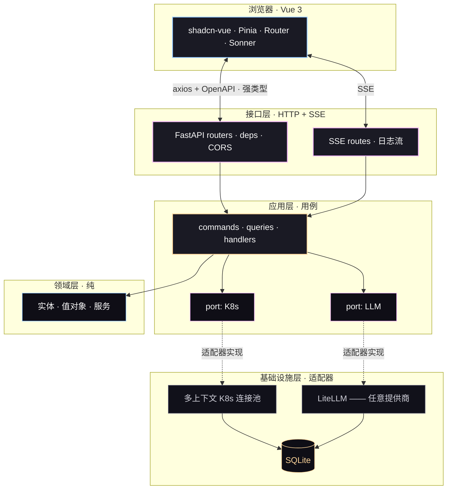

<div align="center">


<br/>

**给已经会 kubectl 的开发者的 K8s 仪表盘。**

<br/>

<a href="#-quick-start"></a>&nbsp;
<a href="https://github.com/mcgrapeng/Spotlight/discussions"></a>&nbsp;
<a href="#-sponsor"></a>

<br/>


<br/>

<a href="./README.md">English</a> &nbsp;·&nbsp;
<a href="./README.zh-CN.md"><b>简体中文</b></a>

</div>

<br/>

## 🛰️ 一屏概览

Spotlight 是给**已经会 `kubectl`** 的开发者的 K8s 仪表盘 —— 把 kubeconfig 里的所有集群汇总到一个视图，实时流式拉取 Pod 日志，把乱的那一坨丢给你选的 LLM，让它直接告诉你**为什么**。

- 🧭 **多集群 kubeconfig，一块屏幕** —— 实时切换 context，无需重启
- 📜 **实时日志流（SSE）** —— 多 Pod 选择，ANSI 保留，去重，可下载
- 🤖 **AI 日志解读，模型自选** —— OpenAI · Anthropic · Bedrock · Gemini · Ollama · 通过 LiteLLM 支持 100+
- ⌨️ **键盘先行** —— `⌘K` 命令面板，`g d / p / n / e / f / a` 跨页跳转
- 🧱 **可插拔鉴权** —— bearer · session · Teleport tsh · 自定义插件（一个文件）
- 🔍 **端到端强类型** —— Pydantic v2 → OpenAPI → `openapi-typescript`

<br/>

## 📑 目录

| 章节 | |
|---|---|
| [一句话](#-the-pitch) | 一句话讲清 Spotlight |
| [为什么做这个](#-why-we-built-this) | 起源故事 |
| [60 秒走完一圈](#-60-second-tour) | 关键页面截图 |
| [这一屏，全特性](#-what-you-get) | 功能清单 |
| [和熟悉工具的对比](#-vs-the-field) | Spotlight vs kubectl / Dashboard / Lens |
| [AI 是怎么工作的](#-ai-in-action) | AI 分析器真实输出样例 |
| [它怎么造的](#-how-its-built) | 六边形架构图 |
| [三分钟上手](#-quick-start) | 3 条命令跑起来 |
| [技术栈](#-stack) | 技术栈徽章 |
| [AI 提供商](#-ai-providers) | 如何添加 / 切换 LLM |
| [路线图](#-coming-next) | 接下来要做的 |
| [参与贡献](#-contributing) | 如何帮忙 |
| [仓库布局](#-project-layout) | 仓库结构 |
| [FAQ](#-faq) | 常见问题 |
| [开发](#-development) | 本地开发配置 |
| [社区](#-community) | 讨论区、issue、聊天 |
| [赞助](#-sponsor) | 支持项目 |
| [⭐ Star 历史](#-star-history) | 增长曲线 |
| [许可证 · 致谢](#-license) | MIT + 致谢 |

<br/>

## 🎯 一句话

> `kubectl` 告诉你**发生了什么**。
> `Kubernetes Dashboard` 告诉你**在哪里**。
> **Spotlight** 告诉你 ***为什么***。

<br/>

## 🕰️ 为什么做这个

> *凌晨两点我们在排查一次生产事故。Pod 在疯狂 crash-loop。`kubectl logs` 显示 21,320 次重启，Dashboard 显示 Pod "Running"。没人告诉我们**为什么**。我们花了 40 分钟翻日志，最后在第 88 行找到 OOMKilled。那一刻我们决定：能展示仪表盘的工具，也应该能展示诊断。*

每个 AI 团队最终都会撞同一堵墙：**kubectl 给 "what"，Dashboard 给 "where"，但没人给 "why"。** 日志散落在 Pod、重启、事件里，答案永远在那儿 —— 埋在凌晨两点没人愿意看完的 200 行日志里。

Spotlight 是架在它们之上的那一层：把所有集群拉到一个视图，实时流式日志，把乱的那一坨丢给你选的 LLM，让它给出贴合上下文的解释。不是 SaaS，不锁供应商，你的集群、你的数据、你的模型。

<br/>

## 📸 60 秒走完一圈

| | |
|---|---|
| **01 · 登录**<br/><br/><sub>Bearer、Teleport tsh、session —— 30 秒，无注册。</sub> | **02 · 看集群**<br/><br/><sub>健康度、压力、信号，一屏看完。</sub> |
| **03 · 挑吵闹的 Pod**<br/><br/><sub>实时状态、重启次数、命名空间筛选。</sub> | **04 · 让 LLM 解释**<br/><br/><sub>拉最近 200 行，点 <em>分析</em>。</sub> |

<br/>

## ✅ 这一屏，全特性

- **🧭 多集群，一块屏幕** —— 实时切换你 shell 已经认的 `KUBECONFIG`，不重启。
- **📜 实时日志流（SSE）** —— 多 Pod 选择，ANSI 颜色保留，去重，可下载。
- **🤖 AI 日志解读，模型自选** —— 带上你自己的 key；OpenAI · Anthropic · Bedrock · Gemini · Ollama · 通过 LiteLLM 支持 100+。
- **⌨️ 键盘先行** —— `⌘K` 命令面板 · `g d / p / n / e / f / a` 跨页跳 · 全程不用鼠标。
- **🧱 可插拔鉴权** —— bearer · session · Teleport tsh · 自定义插件（一个文件）。
- **🔍 端到端强类型** —— Pydantic v2 → OpenAPI → `openapi-typescript`。前端漂不出后端。
- **🧪 六边形 / 整洁架构** —— 每个 port 都有 mock，每个 adapter 都有测试，e2e 覆盖关键路径。

<br/>

## ⚖️ 和熟悉工具的对比

| &nbsp; | `kubectl` | Dashboard | Lens | **Spotlight** |
|---|---|---|---|---|
| 多集群切换 | `kubectx` | 手动 | ✔ | **✔ 实时** |
| 实时日志流 | `kubectl logs -f` | ✔ | ✔ | **✔ 多 Pod + 去重** |
| AI 日志解读 | ✗ | ✗ | ✗ | **✔ 任选 LLM** |
| 可插拔鉴权 | ✗ | ✗ | 部分 | **✔ 一个文件** |
| API → UI 强类型 | ✗ | ✗ | ✗ | **✔ Pydantic → TS** |
| 自托管，无注册 | ✔ | ✔ | 部分 | **✔** |

> Spotlight 不替代 `kubectl`。它架在 `kubectl` 之上 —— 把仪表盘、轨迹、诊断一起给你，快。

<br/>

## 🤖 AI 是怎么工作的

> 从任意 Pod 拉最多 200 行日志，点 *分析*，选个模型 —— 真实输出长这样：

```text
▸ AI · claude-3-5-sonnet · 1.42s · tokens 412 in / 286 out

  Root cause
    Pod 在被 OOMKilled。容器 RSS 在 17:42:08 触到 512 MiB 上限；
    内核发了 SIGKILL（exit 137）；最近 5 分钟 Kubernetes 重启了
    21,320 次。

  Evidence
    L17  "oom score adj = 950"
    L23  "memory.peak = 512MiB / limit 512MiB"
    L88  "loki-write: signal SIGKILL, exit code 137"

  Suggested fix
    • 把 Helm values 里的 memory.limit 提到 768 MiB，或
    • 把 ingester 配置里的 WAL 保留从 24h 砍到 6h，或
    • 给租户分片 —— 按 label 切到 3 个副本。
```

<br/>

## 🏗️ 它怎么造的

六边形 / 整洁架构 —— **`domain/` 和 `application/` 不知道 Kubernetes、AI、HTTP 的存在**；脏活全在 `infrastructure/` 适配器里。



> **想加一个鉴权提供商、日志源、或 LLM？** 在 `infrastructure/<thing>/` 加一个适配器实现对应的 port，再注册一下。其余都不动。

<br/>

## 🚀 三分钟上手

**Spotlight 是两个进程。跑起来，让它指向你的 kubeconfig，打开 `http://localhost:5173`。**

```bash
# 1. 后端 —— FastAPI 跑在 :8002
cd backend
python -m venv .venv && source .venv/bin/activate
pip install -r requirements.txt
cp .env.example .env
uvicorn app.main:app --reload --port 8002

# 2. 前端 —— Vue 3 跑在 :5173，开第二个终端
cd frontend
pnpm install
pnpm dev
```

打开 <http://localhost:5173>。用任意 `Authorization: Bearer <token>` 登录 —— 在 `backend/.env` 里设 `API_TOKEN=<your-token>`。**本地开发，把 `API_TOKEN` 和 `TELEPORT_*` 都留空** —— 应用会以 API 全开放模式启动，并打一条启动警告。

> **在用 Teleport？** 在 `.env` 里设 `TELEPORT_PROXY` / `TELEPORT_AUTH` / `TELEPORT_CLUSTER`。Spotlight 走 per-session 的 `tsh login`，不需要 kubeconfig。

<br/>

## 🧱 技术栈

**后端** —— FastAPI · Pydantic v2 · kubernetes-python · LiteLLM · SQLAlchemy (async + aiosqlite) · structlog

**前端** —— Vue 3 · Vite · Tailwind CSS · reka-ui / shadcn-vue · Pinia · vue-sonner · axios · openapi-typescript

**测试** —— pytest · Vitest · Playwright · axe-core

<br/>

## 🔌 AI 提供商

底层是 **LiteLLM**。Provider 配置**存在 SQLite（`ai_providers` 表），在前端管理** —— **Settings → AI**。要加 OpenAI、Anthropic、Bedrock、Gemini、Ollama，或任何 OpenAI 兼容端点：填 key、选模型、保存。

> **没有 `AI_PROVIDER` 环境变量。** 切换 provider 是 UI 动作 —— 选另一行就行，不重启、不重建。LiteLLM 把同一种调用形状路由到你保存的那个 provider。

`SQLAIProviderRepository`（在 `backend/app/infrastructure/ai/providers/sql_provider.py`）是唯一事实来源；`LiteLLMAIRepository` 每次按它来路由。

<br/>

## 🛣️ 路线图

- [x] <sub>`v2.0`</sub> &nbsp; **现在** —— 多集群 kubeconfig、SSE 日志流、LiteLLM、Spotlight UI v6、六边形后端。
- [ ] <sub>`v2.1`</sub> &nbsp; Helm chart 部署 · 单二进制模式 · SQLite → Postgres 迁移。
- [ ] <sub>`v2.2`</sub> &nbsp; RBAC 感知视图 · 多用户 session 隔离 · 审计日志 UI。
- [ ] <sub>`v3.0`</sub> &nbsp; Plugin SDK（第三方 LLM 分析器、自定义日志解析器）· 鉴权的**公开只读分享**链接。

> 如果某项功能对你很重要，开个 Discussion —— 路线图跟着大家实际怎么用走。

<br/>

## 🤝 参与贡献

任何规模的贡献都欢迎 —— bug 报告、文档、代码、AI provider 适配器。

```bash
git clone https://github.com/mcgrapeng/Spotlight.git && cd Spotlight

cd backend
python -m venv .venv && source .venv/bin/activate
pip install -r requirements.txt
pytest -q

cd ../frontend && pnpm install
pnpm test           # Vitest —— 单元
pnpm test:e2e       # Playwright —— 浏览器
```

> 单包开发指南：[`backend/README.md`](./backend/README.md) · [`frontend/README.md`](./frontend/README.md)
>
> 架构规则：`domain/` 和 `application/` 永不直接 import `kubernetes` 或 `litellm` —— 它们跨过 `application/ports/` 里声明的 port。要加新的鉴权 provider、LLM、或日志源 —— 在 `infrastructure/` 实现匹配的适配器并通过 DI 接入。

<br/>

## 🗂️ 仓库布局

```
Spotlight/
├── backend/                   FastAPI · 六边形 / 整洁架构
│   ├── app/
│   │   ├── application/       use cases + ports（出站接口）
│   │   ├── domain/            entities · value objects · services
│   │   ├── infrastructure/    适配器：ai, auth, cache, config, k8s, logging, persistence
│   │   ├── interface/         api/（routers · DTOs）+ sse/（事件流）
│   │   └── main.py
│   ├── tests/                 pytest —— 单元 + 集成
│   └── requirements.txt
├── frontend/                  Vue 3 + Vite + Tailwind + shadcn-vue
│   ├── src/
│   │   ├── components/        ui/, layout/, common/, pod/, dashboard/, log/, ai/
│   │   ├── views/             9 个页面（Login, Dashboard, Pods, PodDetail, Nodes, Events, Favorites, AISettings, Settings）
│   │   ├── stores/            Pinia
│   │   ├── api/               axios + openapi-typescript 生成
│   │   └── styles/            设计 tokens
│   └── package.json
├── assets/                    banner, divider, logo, README 截图
├── LICENSE                    MIT
├── README.md  ·  README.zh-CN.md
└── …                          配置 + 工具
```

<br/>

## ❓ FAQ

<details>
<summary><b>Spotlight 生产可用吗？</b></summary>

可用。v2.0 包含六边形架构、类型化 API 契约、SSE 日志流，覆盖关键 port 的测试套件。只有 AI 分析器依赖外部 LLM —— 其他全部离线跑。

</details>

<details>
<summary><b>和 Lens 或 k9s 怎么比？</b></summary>

Lens 是 K8s 全功能 IDE —— 探索资源很爽，但不做 AI 日志分析。k9s 是终端 UI —— 快、极简，但没有 Web 仪表盘。Spotlight 夹在中间：带 AI 日志诊断的 Web 仪表盘。看上面的 [对比表](#-vs-the-field)。

</details>

<details>
<summary><b>能用自己的 LLM 端点吗？</b></summary>

可以。打开 **Settings → AI**，点 **Add provider**，选 `custom`，填任意 OpenAI 兼容端点（Ollama、vLLM、LM Studio 等）的 base URL。模型名同表单填。这一行存到 SQLite，下一次请求就用 —— 不重启。

</details>

<details>
<summary><b>Spotlight 会保存我的集群凭据吗？</b></summary>

不会。Spotlight 运行时只读 `KUBECONFIG`，从不持久化集群凭据。登录用的 `API_TOKEN` 存在 `backend/.env`（gitignored）。Teleport session 是 per-session，会过期。

</details>

<details>
<summary><b>怎么加新的鉴权 provider？</b></summary>

在 `backend/app/infrastructure/auth/plugins/` 实现 `AuthPlugin` 接口，在插件 `REGISTRY`（`backend/app/infrastructure/auth/plugins/__init__.py`）里注册一行，再在 `.env` 里设 `AUTH_PROVIDER=<your-plugin-id>`。登录表单会自动适配插件的 `form_fields()`。

</details>

<details>
<summary><b>有 Docker 镜像吗？</b></summary>

还没有 —— v2.1 路线图包含 Helm chart 和单二进制模式。目前直接跑两个进程（见 [三分钟上手](#-quick-start)）。

</details>

<br/>

## 🛠️ 开发

### 环境要求

- Python 3.11+ · Node.js 20+ · pnpm
- 一个至少有一个 context 的 `kubeconfig`（任意集群，含 `minikube` / `kind`）

### 本地开发

```bash
# 后端（端口 8002，热重载）
cd backend && source .venv/bin/activate
uvicorn app.main:app --reload --port 8002

# 前端（端口 5173，热重载）
cd frontend && pnpm dev
```

### 测试

```bash
# 后端 —— 单元 + 集成
cd backend && pytest -q

# 前端 —— 单元（Vitest）
cd frontend && pnpm test

# 前端 —— E2E（Playwright，headless Chromium）
cd frontend && pnpm test:e2e
```

### 类型检查

```bash
# 后端必须在 :8002 跑着 —— 脚本读 /openapi.json
cd frontend && pnpm types:check
```

> **架构规则：** `domain/` 和 `application/` 永不直接 import `kubernetes` 或 `litellm`。一切跨过 `application/ports/` 里声明的 port。要加新的鉴权 provider、LLM、或日志源 —— 实现匹配的适配器并注册。

<br/>

## 💬 社区

- 💬 **[讨论区](https://github.com/mcgrapeng/Spotlight/discussions)** —— 提问、分享用例、提议功能
- 🐛 **[Issues](https://github.com/mcgrapeng/Spotlight/issues)** —— bug 报告和功能请求
- 📖 **[参与贡献](#-contributing)** —— 怎么开始
- 📦 **[Releases](https://github.com/mcgrapeng/Spotlight/releases)** —— changelog 和版本历史

<br/>

## ❤ 赞助

Spotlight 是 MIT 协议，对所有人免费。如果它在凌晨两点救过你的团队，一笔赞助能帮这个项目继续转。

<a href="https://github.com/sponsors/mcgrapeng">💖 在 GitHub 上赞助</a>

<br/>

## ⭐ Star 历史

<a href="https://star-history.com/#mcgrapeng/Spotlight&Date">
  <picture>
    <source media="(prefers-color-scheme: dark)" srcset="https://api.star-history.com/svg?repos=mcgrapeng/Spotlight&type=Date&theme=dark" />
    <source media="(prefers-color-scheme: light)" srcset="https://api.star-history.com/svg?repos=mcgrapeng/Spotlight&type=Date" />
    
  </picture>
</a>

<br/>

## 📄 许可证 · 致谢

[MIT](./LICENSE) —— 怎么用都行，保留版权就行。

Spotlight 站在 **FastAPI**、**Pydantic**、**SQLAlchemy**、**LiteLLM**、**kubernetes-python**、**Vue 3**、**Vite**、**Tailwind CSS**、**shadcn-vue**、**reka-ui**、**Pinia**、**vue-sonner**、**axios**、**Playwright**、**Vitest**、**pytest**、**structlog** 的肩膀上。

<br/>

<div align="center" style="padding: 40px 0 16px;">

<sub>Spotlight · 给已经会 <code>kubectl</code> 的开发者。</sub>

<br/>

<a href="https://github.com/mcgrapeng/Spotlight/issues"><b>🐛 Issues</b></a> · 
<a href="https://github.com/mcgrapeng/Spotlight/discussions"><b>💬 讨论区</b></a> · 
<a href="https://github.com/mcgrapeng/Spotlight/releases"><b>📦 Releases</b></a> · 
<a href="https://github.com/sponsors/mcgrapeng"><b>❤ 赞助</b></a>

</div>