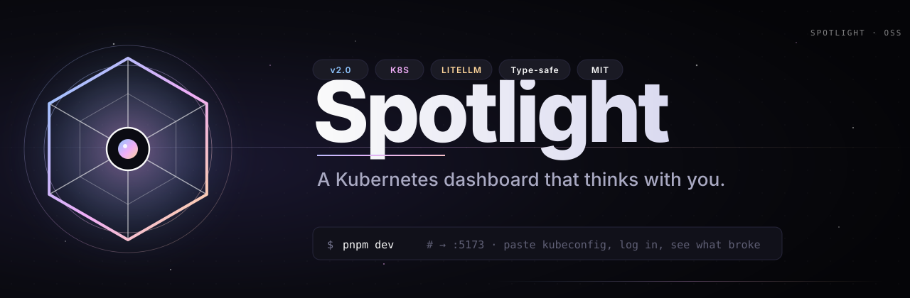
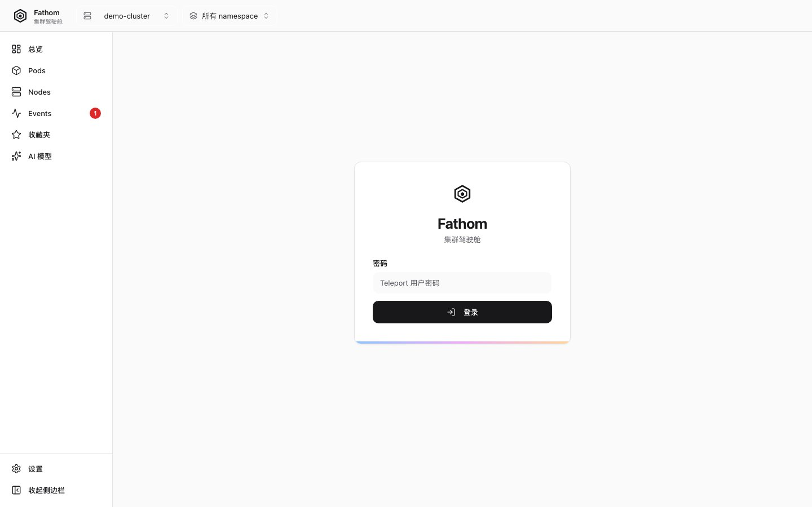
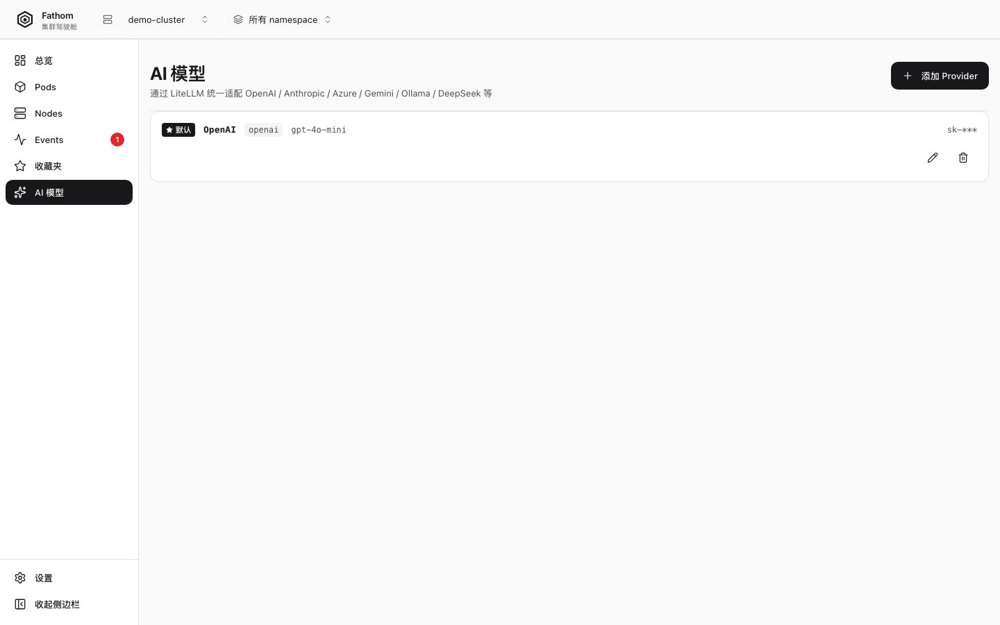
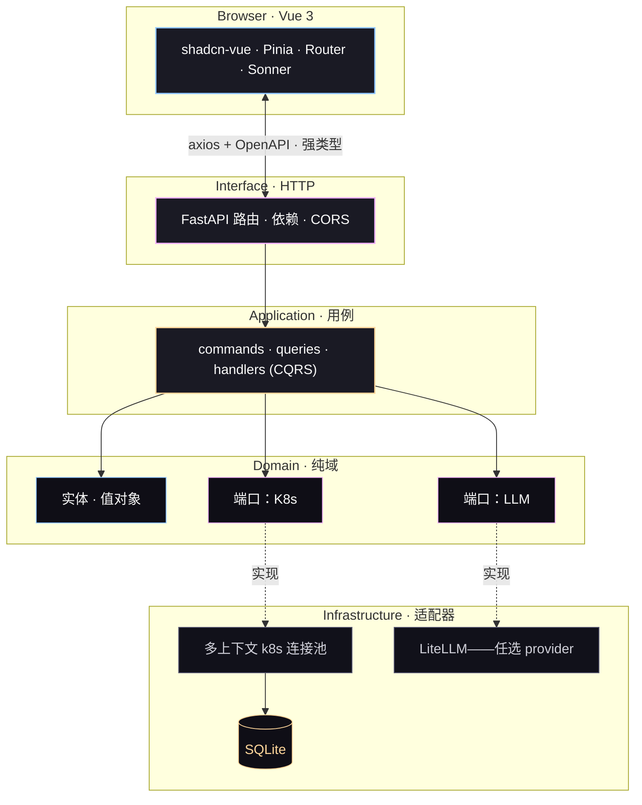

<!--
  Layout philosophy (top -> bottom) · 布局哲学：

  1.  Banner 品牌大图（视觉锚点）
  2.  TL;DR 卡片（4 颗彩 chip，一屏看完，可扫读）
  3.  CTA 按钮条（黑 / 粉 / 蓝 / 黄四枚品牌色）
  4.  极小徽章行（许可 / python / node / k8s）
  5.  语言切换
  6.  品牌分隔线
  7.  THE PITCH · 一句话（左 brand-color 边、渐变高亮）
  8.  分隔线
  9.  60-SECOND TOUR（2x2 网格，截图更大更有空气）
 10.  分隔线
 11.  WHAT YOU GET 4x2 特性网格
 12.  分隔线
 13.  VS THE FIELD 对比表（精简）
 14.  分隔线
 15.  AI IN ACTION 终端代码块
 16.  分隔线
 17.  ARCHITECTURE Mermaid（品牌色）
 18.  分隔线
 19.  QUICK START 三分钟上手
 20.  分隔线
 21.  STACK 徽章矩阵
 22.  分隔线
 23.  AI PROVIDERS
 24.  分隔线
 25.  COMING NEXT 路线图
 26.  分隔线
 27.  CONTRIBUTING 参与贡献
 28.  分隔线
 29.  PROJECT LAYOUT
 30.  分隔线
 31.  SPONSOR 赞助卡片
 32.  分隔线
 33.  STAR HISTORY
 34.  分隔线
 35.  LICENCE · ACKNOWLEDGEMENTS
 36.  FOOTER 品牌结尾
-->

<div align="center">



<br/>

<table align="center" cellpadding="0" cellspacing="0" style="margin: 8px auto 12px; border-collapse:collapse;">
  <tr>
    <td align="center" style="padding:8px 18px;background:#0B0B12;color:#FAFAFA;border:1px solid #26253A;border-radius:999px;font-family:ui-sans-serif,system-ui,sans-serif;font-size:14px;font-weight:600;">🌐 多集群</td>
    <td align="center" width="8"></td>
    <td align="center" style="padding:8px 18px;background:#EFADF7;color:#18181B;border:1px solid #EFADF7;border-radius:999px;font-family:ui-sans-serif,system-ui,sans-serif;font-size:14px;font-weight:600;">🤖 AI 日志</td>
    <td align="center" width="8"></td>
    <td align="center" style="padding:8px 18px;background:#8EC5FF;color:#18181B;border:1px solid #8EC5FF;border-radius:999px;font-family:ui-sans-serif,system-ui,sans-serif;font-size:14px;font-weight:600;">🧠 自带 LLM</td>
    <td align="center" width="8"></td>
    <td align="center" style="padding:8px 18px;background:#FFD69B;color:#18181B;border:1px solid #FFD69B;border-radius:999px;font-family:ui-sans-serif,system-ui,sans-serif;font-size:14px;font-weight:600;">🔓 自托管</td>
  </tr>
</table>

<p align="center" style="font-size:20px;color:#1A1A24;">
  <strong>让 Kubernetes 与你对话的驾驶舱。</strong>
</p>

<br/>

<a href="#-quick-start"></a>&nbsp;
<a href="#-star-history"></a>&nbsp;
<a href="https://github.com/anomalyco/Spotlight/discussions"></a>&nbsp;
<a href="#-sponsor--funding"></a>

<br/>


<br/>

<a href="./README.zh-CN.md"><b>简体中文</b></a> &nbsp;·&nbsp;
<a href="./README.md">English</a>

</div>

<br/>

<p align="center">
  
</p>

<br/>

##  &nbsp; 一句话

<table align="center" cellpadding="0" cellspacing="0" style="margin: 0 auto; border-collapse: collapse; max-width: 720px;">
<tr>
<td style="padding: 28px 36px; background: linear-gradient(180deg, #FAFAFA 0%, #F5F5F8 100%); border-left: 4px solid #EFADF7; border-radius: 8px;">
  <p style="margin: 0; font-family: ui-sans-serif, system-ui, -apple-system, 'PingFang SC', 'Microsoft YaHei', sans-serif; font-size: 19px; line-height: 1.65; color: #0B0B12;">
    <code style="background: rgba(0,0,0,.06); padding: 2px 7px; border-radius: 4px; color: #0B0B12; font-weight: 700;">kubectl</code>
    告诉你 <strong>发生了什么</strong>。<br/>
    <code style="background: rgba(0,0,0,.06); padding: 2px 7px; border-radius: 4px; color: #0B0B12; font-weight: 700;">Kubernetes&nbsp;Dashboard</code>
    告诉你 <strong>东西在哪</strong>。<br/>
    <code style="background: rgba(0,0,0,.06); padding: 2px 7px; border-radius: 4px; color: #18181B; font-weight: 700;">Spotlight</code>
    告诉你 <strong style="background: linear-gradient(90deg, #8EC5FF, #EFADF7, #FFD69B); -webkit-background-clip: text; background-clip: text; color: transparent;"><em>为什么</em></strong>。
  </p>
</td>
</tr>
</table>

<br/>

Spotlight 是给「已经会用 `kubectl` 的人」准备的、有主张的 Kubernetes 驾驶舱：把你 `kubeconfig` 里所有集群收进同一个界面，实时流式拉取 Pod 日志，再把乱七八糟的内容交给**你自己选的**大模型，要一份带上下文的解释——**没有云端 SaaS，没有供应商锁定**，你的集群、你的数据、你的模型。

<br/>

<p align="center">
  
</p>

<br/>

##  &nbsp; 60 秒走完一圈

<table align="center">
<tr>
<td width="50%" valign="top" align="center" style="padding: 8px;">

**01 · 登录**



<sub>Bearer / Teleport tsh / Session——30 秒搞定。</sub>

</td>
<td width="50%" valign="top" align="center" style="padding: 8px;">

**02 · 看一眼集群**


<sub>健康度、压力、信号，一屏看完。</sub>

</td>
</tr>
<tr>
<td width="50%" valign="top" align="center" style="padding: 8px;">

**03 · 选那个吵闹的 Pod**


<sub>实时状态、重启计数、命名空间筛选。</sub>

</td>
<td width="50%" valign="top" align="center" style="padding: 8px;">

**04 · 让大模型解释**



<sub>抓最后 200 行，点 <em>Analyze</em>。</sub>

</td>
</tr>
</table>

<br/>

<p align="center">
  
</p>

<br/>

##  &nbsp; 这一屏，全特性

<table>
<tr>
<td width="50%" valign="top">

### 🧭 多集群，一块屏幕
沿用 shell 已有的 `KUBECONFIG`，热切换 context，无需重启。

</td>
<td width="50%" valign="top">

### 📜 实时日志（SSE 流）
多 Pod 选、ANSI 颜色保留、分组去重、一键下载。

</td>
</tr>
<tr>
<td width="50%" valign="top">

### 🤖 AI 日志解读，模型自选
自带 Key——OpenAI · Anthropic · Bedrock · Gemini · Ollama · LiteLLM 支持 100+。

</td>
<td width="50%" valign="top">

### ⌨️ 键盘先行
`⌘K` 命令面板 · `g d / p / n / e / f / a` 跳转页面 · 鼠标可以不用。

</td>
</tr>
<tr>
<td width="50%" valign="top">

### 🧱 可插拔鉴权
Bearer · Session · Teleport tsh · 你自己的插件（一个文件）。

</td>
<td width="50%" valign="top">

### 🔍 端到端强类型
Pydantic v2 → OpenAPI → `openapi-typescript`，前后端不会偷偷漂移。

</td>
</tr>
<tr>
<td width="50%" valign="top">

### 🌑 Appica 设计语言
纯黑 `#18181B` · 纯白 `#FAFAFA` · 1 px 描边 · 一道装饰渐变。

</td>
<td width="50%" valign="top">

### 🧪 可测到 100 %
六边形架构——每个端口可 mock，每个适配器可测，e2e 覆盖关键路径。

</td>
</tr>
</table>

<br/>

<p align="center">
  
</p>

<br/>

##  &nbsp; 和熟悉工具的对比

| &nbsp; | `kubectl` | Dashboard | Lens | **Spotlight** |
|---|---|---|---|---|
| 多集群切换 | `kubectx` | 手动 | ✔ | **✔ 实时** |
| 实时日志流 | `kubectl logs -f` | ✔ | ✔ | **✔ 多 Pod + 去重** |
| AI 日志解读 | ✗ | ✗ | ✗ | **✔ 任选模型** |
| 可插拔鉴权 | ✗ | ✗ | 有限 | **✔ 一个文件** |
| API → UI 强类型 | ✗ | ✗ | ✗ | **✔ Pydantic → TS** |
| 自托管、无注册 | ✔ | ✔ | 有限 | **✔** |

> Spotlight 不替代 `kubectl`。它位于其上——给你看一眼仪表盘、看一眼时间线、看一眼诊断。

<br/>

<p align="center">
  
</p>

<br/>

##  &nbsp; AI 是怎么工作的

> 抓任一 Pod 的最后 200 行，点 *Analyze*，挑模型——真实输出长这样：

```text
▸ AI · claude-3-5-sonnet · 1.42s · tokens 412 in / 286 out

  根因
    这是一个 OOMKill。容器 RSS 在 17:42:08 触顶 512 MiB，
    内核发送 SIGKILL（exit 137），最近 5 分钟被 Kubernetes
    重启了 21,320 次。

  证据
    L17  "oom score adj = 950"
    L23  "memory.peak = 512MiB / limit 512MiB"
    L88  "loki-write: signal SIGKILL, exit code 137"

  处理建议
    • 把 memory.limit 提到 768 MiB（在 Helm values 里），或
    • 把 ingester 的 WAL 保留时间从 24h 砍到 6h，或
    • 把租户切片——按 label 拆到 3 个副本上。
```

> [!TIP]
> **模型可以热换。** 改 `.env` 里的 `AI_PROVIDER`，保存，在 UI 里挑不同的模型——不需要重启。同一调用对 OpenAI、Anthropic、Bedrock、Gemini、Ollama，或**任何 OpenAI 兼容端点**都生效。

<br/>

<p align="center">
  
</p>

<br/>

##  &nbsp; 它怎么造的

**六边形 / Clean Architecture**——Domain 不知道 Kubernetes、AI、HTTP；适配器知道。



> **想加一种新鉴权、日志源或 LLM？** 在 `infrastructure/<thing>/` 加一个实现端口的适配器并注册到注册表，其它啥都不用动。

<br/>

<p align="center">
  
</p>

<br/>

##  &nbsp; 三分钟上手

**Spotlight 是两个进程。跑起来，指向你的 kubeconfig，打开 `http://localhost:5173`。**

```bash
# 1. 后端 — FastAPI，:8002
cd backend
python -m venv .venv && source .venv/bin/activate
pip install -r requirements.txt
cp .env.example .env
uvicorn app.main:app --reload --port 8002

# 2. 前端 — Vue 3，:5173（另起一个终端）
cd frontend
pnpm install
pnpm dev
```

打开 <http://localhost:5173>。用任意 `Authorization: Bearer <token>` 登录；只要在 `backend/.env` 里设 `API_TOKEN=<your-token>`——**留空**则是本地开放模式（启动会有告警）。

> **用 Teleport？** 在 `.env` 里设 `TELEPORT_PROXY` / `TELEPORT_AUTH` / `TELEPORT_CLUSTER`，Spotlight 会按会话签发 `tsh login` 凭证——不需要本地 kubeconfig。

<br/>

<p align="center">
  
</p>

<br/>

##  &nbsp; 技术栈

**后端**
<a href="#"></a>
<a href="#"></a>
<a href="#"></a>
<a href="#"></a>
<a href="#"></a>

**前端**
<a href="#"></a>
<a href="#"></a>
<a href="#"></a>
<a href="#"></a>
<a href="#"></a>

**测试**
<a href="#"></a>
<a href="#"></a>
<a href="#"></a>
<a href="#"></a>

<br/>

<p align="center">
  
</p>

<br/>

##  &nbsp; AI 提供商

底层是 **LiteLLM**——一个环境变量就能切，模型在 UI 里换。

| 提供商 | `AI_PROVIDER=` | 在环境变量里 |
|---|---|---|
| **OpenAI** | `openai` | `OPENAI_API_KEY` |
| **Anthropic** | `anthropic` | `ANTHROPIC_API_KEY` |
| **Azure OpenAI** | `azure` | `AZURE_API_KEY` · `AZURE_API_BASE` · `AZURE_API_VERSION` |
| **AWS Bedrock** | `bedrock` | `AWS_ACCESS_KEY_ID` · `AWS_REGION` |
| **Google Gemini / Vertex** | `gemini` / `vertex` | `GEMINI_API_KEY` / `VERTEX_PROJECT` |
| **Ollama（本地）** | `ollama` | `OLLAMA_API_BASE=http://host:11434` |
| **OpenRouter** | `openrouter` | `OPENROUTER_API_KEY` |
| **任何兼容 OpenAI 的 API** | `custom` | `AI_API_BASE` · `AI_API_KEY` |

<br/>

<p align="center">
  
</p>

<br/>

##  &nbsp; 路线图

- [x] <sub>`v2.0`</sub> &nbsp; **当前** — 多集群 kubeconfig · SSE 实时日志 · LiteLLM · Appica UI v6 · 六边形后端。
- [ ] <sub>`v2.1`</sub> &nbsp; Helm chart 部署 · 单二进制模式 · SQLite → Postgres 平滑迁移。
- [ ] <sub>`v2.2`</sub> &nbsp; RBAC 视图 · 多用户会话隔离 · 审计日志 UI。
- [ ] <sub>`v3.0`</sub> &nbsp; 插件 SDK（第三方 LLM 分析器、自定义日志解析器）· **只读公开分享**链接。

> 如果某条对你重要，开个 Discussion——路线图是按真实使用塑形的。

<br/>

<p align="center">
  
</p>

<br/>

##  &nbsp; 参与贡献

任何规模的贡献都欢迎——bug 报告、文档、代码、AI 提供商适配器。

```bash
git clone https://github.com/<you>/Spotlight.git && cd Spotlight

cd backend && source .venv/bin/activate
pip install -r requirements.txt
pytest -q

cd ../frontend && pnpm install
pnpm test           # Vitest —— 单元
pnpm test:e2e       # Playwright —— 浏览器
```

> 各包的开发指南见 [`backend/README.md`](./backend/README.md) · [`frontend/README.md`](./frontend/README.md)
> 一句话架构规则：**只用端口与适配器**——`app/` 里不许漏出 `kubernetes`、`litellm` 这种具体类型。

<br/>

<p align="center">
  
</p>

<br/>

##  &nbsp; 仓库布局

```
Spotlight/
├── backend/                   FastAPI · 六边形 / 整洁架构
│   ├── app/
│   │   ├── application/       commands · queries · handlers（用例）
│   │   ├── domain/            实体 · 值对象 · 端口
│   │   ├── infrastructure/    适配器：k8s, db, 日志, LLM, auth
│   │   ├── interface/api/     FastAPI 路由 / DTO
│   │   └── main.py
│   ├── tests/                 pytest —— 单元 + 集成
│   └── requirements.txt
├── frontend/                  Vue 3 + Vite + Tailwind + shadcn-vue
│   ├── src/
│   │   ├── components/        ui/, layout/, common/, pod/, dashboard/, log/, ai/
│   │   ├── views/             8 个页面（Login, Dashboard, Pods, PodDetail, Nodes, …）
│   │   ├── stores/            Pinia
│   │   ├── api/               axios + openapi-typescript 生成的客户端
│   │   └── styles/            设计 token
│   └── package.json
├── assets/                    品牌 banner / mark / divider / README 截图
├── LICENSE                    MIT
├── README.md  ·  README.zh-CN.md
└── …                          配置与工具链
```

<br/>

<p align="center">
  
</p>

<br/>

##  &nbsp; 赞助

<table align="center" cellpadding="0" cellspacing="0" style="margin: 0 auto; border-collapse: collapse; max-width: 640px;">
<tr>
<td style="padding: 22px 28px; background: linear-gradient(135deg, #FFF7E6 0%, #FFE6F6 100%); border: 1px solid #FFD69B; border-radius: 12px; text-align: left;">
  <div style="font-family: ui-sans-serif, system-ui, 'PingFang SC', 'Microsoft YaHei', sans-serif; font-size: 18px; font-weight: 700; color: #18181B; margin-bottom: 8px;">
    ❤ &nbsp;这是 0 收入项目，靠夜里和周末的副产物。
  </div>
  <div style="font-family: ui-sans-serif, system-ui, 'PingFang SC', 'Microsoft YaHei', sans-serif; font-size: 14px; color: #1A1A24; line-height: 1.6;">
    Spotlight 是 MIT 协议，人人免费。如果它在凌晨两点救过你的命，
    一笔赞助可以让它继续迭代。
  </div>
  <div style="margin-top: 12px;">
    <a href="https://github.com/sponsors/anomalyco" style="display:inline-block; padding: 8px 16px; background:#18181B; color:#FFD69B; border-radius:6px; font-weight:600; text-decoration:none; font-size: 14px;">❤ &nbsp;在 GitHub 上赞助</a>
  </div>
</td>
</tr>
</table>

<br/>

<p align="center">
  
</p>

<br/>

##  &nbsp; ⭐ Star 历史

<a href="https://star-history.com/#anomalyco/Spotlight&Date">
  <picture>
    <source media="(prefers-color-scheme: dark)" srcset="https://api.star-history.com/svg?repos=anomalyco/Spotlight&type=Date&theme=dark" />
    <source media="(prefers-color-scheme: light)" srcset="https://api.star-history.com/svg?repos=anomalyco/Spotlight&type=Date" />
    
  </picture>
</a>

<br/>

<p align="center">
  
</p>

<br/>

##  &nbsp; 许可证 · 致谢

[MIT](./LICENSE)——随便用，保留版权就行。

Spotlight 站在这些肩膀上：**FastAPI**、**Pydantic**、**SQLAlchemy**、**LiteLLM**、**kubernetes-python**、**Vue 3**、**Vite**、**Tailwind CSS**、**shadcn-vue**、**Radix Vue**、**Pinia**、**Lucide**、**Axios**、**Playwright**、**Vitest**、**pytest**、**structlog**。

<br/>

<div align="center" style="padding: 40px 0 16px;">


<br/><br/>

<sub>Spotlight · 给已经会 <code>kubectl</code> 的人。</sub>

<br/><br/>

<table align="center" cellpadding="0" cellspacing="0" style="border-collapse: collapse; margin: 0 auto;">
<tr>
<td align="center" style="padding: 4px 14px;"><a href="./README.zh-CN.md"><b>📖 文档</b></a></td>
<td align="center" style="padding: 4px 14px; color:#D1D9E0;">·</td>
<td align="center" style="padding: 4px 14px;"><a href="https://github.com/anomalyco/Spotlight/issues"><b>🐛 问题</b></a></td>
<td align="center" style="padding: 4px 14px; color:#D1D9E0;">·</td>
<td align="center" style="padding: 4px 14px;"><a href="https://github.com/anomalyco/Spotlight/discussions"><b>💬 讨论</b></a></td>
<td align="center" style="padding: 4px 14px; color:#D1D9E0;">·</td>
<td align="center" style="padding: 4px 14px;"><a href="https://github.com/anomalyco/Spotlight/releases"><b>📦 发布</b></a></td>
<td align="center" style="padding: 4px 14px; color:#D1D9E0;">·</td>
<td align="center" style="padding: 4px 14px;"><a href="https://github.com/sponsors/anomalyco"><b>❤ 赞助</b></a></td>
</tr>
</table>

</div>
